# COLABEX — FACULTY / GUIDE MODULE
# PHASE 2.1: AUTHORITATIVE IMPLEMENTATION SEQUENCE, DEPENDENCY GRAPH & UNIT GATE ROADMAP

**Date:** November 23, 2026  
**Author Roles:** Principal SaaS Architect, Senior Frontend Architect, ASP.NET Core Backend Architect, Database Architect, Application Security Auditor and Independent QA Lead  
**Working Branch:** `integration/super-admin-college-admin`  
**Protected HOD Baseline:** Commit `bd5bfc759cc9c46befa04e6ea8c26c84862acea4`  
**Target:** Authoritative Phased Execution Roadmap for Faculty / Guide Phase 3 Frontend Implementation  

---

## 1. IMPLEMENTATION METHODOLOGY & CORE PRINCIPLES

To ensure that the Faculty / Guide module transitions smoothly from specification to a hardened production reality, the Phase 3 frontend implementation must adhere strictly to five non-negotiable architectural principles:

1. **Zero Mock Data Policy:**
   - No mock arrays (`assignedDefenseTeams`, `eval-team-01`, synthetic student scores).
   - No in-memory store mutations (`useProjectHubStore`) for persistent academic records.
   - All data displayed in the UI must originate from verified ASP.NET Core API endpoints.
2. **Incremental, Componentized Deconstruction:**
   - The monolithic `FacultyView.tsx` (1,540 lines) must be decommissioned in structured, testable units rather than an all-at-once rewrite.
   - Each screen must be authored as an independent, single-responsibility feature view under `web/src/features/faculty/views/`.
3. **Strict Baseline & Git Worktree Protection:**
   - Preserve all 33 pre-existing modified files in Super Admin, College Admin, and Navigation directories.
   - Protect the frozen HOD baseline at commit `bd5bfc7` (zero modifications to `HodController.cs`).
   - Zero destructive git commands (`git reset`, `git clean`, `git checkout`).
4. **Authentic Binary Streaming & Security:**
   - File downloads must stream real binary blobs via authenticated endpoints (`GET /api/artifacts/{id}/download`).
   - Fake client-side PDF generation (`%PDF-1.4%`) must be eliminated.
5. **Contract-Driven Testing & Gate Verification:**
   - Each implementation unit must satisfy explicit entry preconditions, automated test verifications, and exit gate acceptance criteria before proceeding to the next unit.

---

## 2. AUTHORITATIVE DEPENDENCY GRAPH (CONTRADICTIONS RESOLVED)

The dependency mismatches from previous iterations (Unit 3.9 depending on 3.4, Unit 3.10 depending on 3.8) are resolved into a single, authoritative dependency graph:

```mermaid
flowchart TD
    Unit1["Phase 3.1: API Service Layer & TypeScript Contracts"] --> Unit2["Phase 3.2: Reusable Domain Components & Design Tokens"]
    
    %% Core Mentorship Path
    Unit2 --> Unit3["Phase 3.3: Action Queue & Faculty Dashboard (/faculty)"]
    Unit3 --> Unit4["Phase 3.4: Mentored Teams Directory & Workspace (/teams & /teams/[id])"]
    Unit4 --> Unit5["Phase 3.5: Proposal Review & Decision Workflow (/proposals)"]
    Unit4 --> Unit6["Phase 3.6: Weekly Progress Logs Sign-off (/logs)"]
    Unit4 --> Unit7["Phase 3.7: Capstone Deliverables Review & Download (/deliverables)"]
    
    %% Prerequisite Gating for Viva Scoring
    Unit7 --> Unit8["Phase 3.8: Viva Defense Rubric & Scoring Matrix (/evaluations)"]
    
    %% Decoupled Workflows
    Unit2 --> Unit9["Phase 3.9: Campus Problem Bank (/problem-bank)"]
    Unit2 --> Unit10["Phase 3.10: Coordinator Console Real Integration (/coordinator)"]
```



### Critical Path Analysis:
- **Primary Critical Path:** Phase 3.1 $\rightarrow$ Phase 3.2 $\rightarrow$ Phase 3.3 $\rightarrow$ Phase 3.4 $\rightarrow$ Phase 3.7 $\rightarrow$ Phase 3.8.
- **Viva Prerequisite Gate:** Phase 3.8 (Viva Defense Scoring) depends strictly on Phase 3.7 (Deliverables Review) because Final Viva requires verified `FinalThesis` and `PlagiarismReport` deliverables in the backend (`FacultyController.cs:580-588`).
- **Problem Bank Decoupling:** Phase 3.9 (Campus Problem Bank) depends only on Phase 3.1 (types) and Phase 3.2 (reusable modals/cards). It does NOT depend on team workspaces or action queues.
- **Coordinator Console Decoupling:** Phase 3.10 (Coordinator Console) depends only on Phase 3.1 (API contracts) and Phase 3.2 (modals/tables). It does NOT depend on Viva defense scoring.

---

## 3. DETAILED UNIT-BY-UNIT IMPLEMENTATION SPECIFICATIONS (PHASES 3.1 TO 3.10)

### Phase 3.1: API Service Layer & TypeScript Contract Alignment
- **Objective:** Establish type-safe, complete frontend connectivity for all verified backend endpoints.
- **Scope:**
  - Update `web/src/lib/api/types.ts`.
  - Extend `web/src/lib/api/facultyApi.ts`.
  - Clean up `web/src/lib/api/coordinatorApi.ts`.
- **Files Expected to Change:**
  - `web/src/lib/api/types.ts`
  - `web/src/lib/api/facultyApi.ts`
  - `web/src/lib/api/coordinatorApi.ts`
- **Dependencies:** None (Entry unit).
- **API Prerequisites:** Backend Phase 1.3 verified (113/113 tests passing).
- **Security Requirements:** All requests must transmit `Authorization: Bearer <token>` via `apiClient`.
- **Acceptance Criteria:**
  1. `types.ts` defines `VerifyLogRequest { decision?: string; isApproved?: boolean; remarks?: string }`.
  2. `types.ts` defines `ReturnProposalRequest { remarks: string; reason?: string }`.
  3. `facultyApi.ts` exposes `returnProposal`, `rejectProposal`, and `getAssignedDefenseTeams`.
  4. Non-existent `GET /api/coordinator/exceptions` removed from `coordinatorApi.ts`.
- **Tests:** `npm run lint` and `npx tsc --noEmit` pass with 0 errors.
- **Exit Conditions:** All API service methods compile without TypeScript errors.
- **Explicit Exclusions:** No UI view changes in this unit.

---

### Phase 3.2: Reusable Domain Components & Workspace Shell
- **Objective:** Author modular, single-responsibility UI building blocks adhering strictly to the Colabex Design System.
- **Scope:**
  - Implement 8 reusable components under `web/src/features/faculty/components/`.
- **Files Expected to Change:**
  - `web/src/features/faculty/components/FacultyStatCard.tsx`
  - `web/src/features/faculty/components/ActionQueueTable.tsx`
  - `web/src/features/faculty/components/MentoredTeamCard.tsx`
  - `web/src/features/faculty/components/WeeklyLogInspectionDrawer.tsx`
  - `web/src/features/faculty/components/ProposalReviewDrawer.tsx`
  - `web/src/features/faculty/components/ProposalDecisionModal.tsx`
  - `web/src/features/faculty/components/DeliverableVaultTable.tsx`
  - `web/src/features/faculty/components/ProblemStatementModal.tsx`
- **Dependencies:** Phase 3.1 complete.
- **API Prerequisites:** Type definitions from Phase 3.1.
- **Security Requirements:** Sanitized HTML rendering; no unsafe inline script evaluation.
- **Acceptance Criteria:**
  1. All components use design system primitives (`Card`, `Badge`, `Button`, `SlideOverDrawer`, `Modal`).
  2. Zero mock data arrays inside component bodies.
  3. Proper prop typing for loading, empty, and disabled states.
- **Tests:** Storybook / unit test rendering checks.
- **Exit Conditions:** All components render cleanly with typed props.
- **Explicit Exclusions:** No routing or page alterations in this unit.

---

### Phase 3.3: Action Queue & Faculty Dashboard (`/faculty`)
- **Route:** `/faculty`
- **View:** `FacultyDashboardView.tsx`
- **Objective:** Build the central operational landing page and wire live priority action queue.
- **Files Expected to Change:**
  - `web/src/app/(dashboard)/faculty/page.tsx`
  - `web/src/features/faculty/views/FacultyDashboardView.tsx`
  - `web/src/navigation/routeRegistry.ts` (Dynamic breadcrumbs & real badge counter)
- **Dependencies:** Phase 3.2 complete.
- **API Prerequisites:** `GET /api/faculty/action-queue`, `GET /api/faculty/mentored-teams`.
- **Security Requirements:** Role guard `FacultyOrAbove`.
- **Acceptance Criteria:**
  1. Executive KPI ribbon displays real counts (Mentored Teams, Pending Logs, Pending Proposals, Assigned Defense Panels).
  2. Action queue table renders pending logs and proposals sorted by submission date.
  3. Clicking "Verify" opens `WeeklyLogInspectionDrawer`; clicking "Review" opens `ProposalReviewDrawer`.
  4. Badge `pendingFacultyCount` reflects `pendingLogsCount + pendingProposalsCount`.
  5. Dynamic breadcrumb resolves `{CollegeName} • {DepartmentCode}` from tenant context.
- **Tests:** Production Next.js build; verify live data from PostgreSQL database.
- **Exit Conditions:** Approving a log immediately updates queue count and refreshes UI.
- **Explicit Exclusions:** No defense rubric grading on this screen.

---

### Phase 3.4: Mentored Teams Directory & Dedicated Team Workspace (`/faculty/teams` & `/faculty/teams/[teamId]`)
- **Routes:** `/faculty/teams` and `/faculty/teams/[teamId]`
- **Views:** `FacultyTeamsView.tsx` and `FacultyTeamWorkspaceView.tsx`
- **Objective:** Implement portfolio directory and deep-linked team supervision workspace with browser history support.
- **Files Expected to Change:**
  - `web/src/app/(dashboard)/faculty/teams/page.tsx`
  - `web/src/app/(dashboard)/faculty/teams/[teamId]/page.tsx` (New Next.js dynamic route)
  - `web/src/features/faculty/views/FacultyTeamsView.tsx`
  - `web/src/features/faculty/views/FacultyTeamWorkspaceView.tsx`
- **Dependencies:** Phase 3.3 complete.
- **API Prerequisites:** `GET /api/faculty/mentored-teams`, `GET /api/faculty/teams/{teamId}/artifacts`.
- **Security Requirements:** 403 Forbidden state rendered if unassigned faculty accesses team workspace.
- **Acceptance Criteria:**
  1. `/faculty/teams` displays guided teams with search, status filters, and repository links.
  2. Clicking "Open Workspace" navigates to `/faculty/teams/[teamId]`.
  3. `/faculty/teams/[teamId]` loads on page refresh with proper breadcrumbs (`My Teams / {TeamCode}`).
  4. Workspace features Overview tab, Proposal Dossier tab, and Deliverables Vault tab.
- **Tests:** Verify deep-link refresh and 403 guard on unauthorized team access.
- **Exit Conditions:** Workspace functions on live API without slide-over drawer context loss.
- **Explicit Exclusions:** No fabricated GitHub commit telemetry; no sprint task mutations.

---

### Phase 3.5: Proposal Review & Decision Workflow (`/faculty/proposals`)
- **Route:** `/faculty/proposals`
- **View:** `FacultyProposalsView.tsx`
- **Objective:** Dedicated review queue for incoming student project proposals.
- **Files Expected to Change:**
  - `web/src/app/(dashboard)/faculty/proposals/page.tsx` (New route)
  - `web/src/features/faculty/views/FacultyProposalsView.tsx`
  - `web/src/navigation/routeRegistry.ts` (Register `/faculty/proposals` in sidebar)
- **Dependencies:** Phase 3.4 complete.
- **API Prerequisites:** `POST /api/faculty/proposals/{teamId}/endorse`, `return`, `reject`.
- **Security Requirements:** Caller must be assigned Guide, Department HOD, or College Admin.
- **Acceptance Criteria:**
  1. Proposal cards display Team Code, Title, Abstract, SDG Code, and Similarity Advisory.
  2. Endorse Proposal calls `POST .../endorse` -> Advances status to `PendingCoordinator`.
  3. Return for Revision calls `POST .../return` with mandatory remarks ($\ge 5$ chars) -> Resets status to `Draft`, preserves guide.
  4. Reject Proposal calls `POST .../reject` with mandatory remarks ($\ge 5$ chars) -> Resets status to `Draft`, revokes guide (`GuideUserId = null`).
- **Tests:** Verify Endorse, Return, and Reject transitions in PostgreSQL.
- **Exit Conditions:** All three transitions execute with toast notifications.
- **Explicit Exclusions:** No HOD final sign-off (HOD boundary respected).

---

### Phase 3.6: Weekly Progress Logs Sign-off (`/faculty/logs`)
- **Route:** `/faculty/logs`
- **View:** `FacultyWeeklyLogsView.tsx`
- **Objective:** Dedicated queue for Friday engineering diary verification.
- **Files Expected to Change:**
  - `web/src/app/(dashboard)/faculty/logs/page.tsx` (New route)
  - `web/src/features/faculty/views/FacultyWeeklyLogsView.tsx`
  - `web/src/navigation/routeRegistry.ts` (Register `/faculty/logs` in sidebar)
- **Dependencies:** Phase 3.4 complete.
- **API Prerequisites:** `GET /api/faculty/action-queue`, `POST /api/faculty/logs/{logId}/verify`.
- **Security Requirements:** Caller must be assigned Guide, Department HOD, or College Admin.
- **Acceptance Criteria:**
  1. Table displays pending Friday logs with Week #, Team Code, Student Name, and Hours Logged.
  2. Inspecting log opens `WeeklyLogInspectionDrawer`.
  3. Verify & Sign calls `POST .../verify` with `{ decision: "Approved" }` -> Sets `isVerified = true`.
  4. Request Revision calls `POST .../verify` with `{ decision: "NeedsRevision", remarks: "..." }` (requires min 5 chars).
- **Tests:** Verify sign-off and revision transitions in PostgreSQL.
- **Exit Conditions:** Verified logs update immediately in UI; queue decrements.
- **Explicit Exclusions:** Historical 12-week completed archive is designated as pending backend endpoint.

---

### Phase 3.7: Capstone Deliverables Review & Download Integration (`/faculty/deliverables`)
- **Route:** `/faculty/deliverables`
- **View:** `FacultyDeliverablesView.tsx`
- **Objective:** Centralized 4-slot capstone deliverable review and authentic binary file streaming.
- **Files Expected to Change:**
  - `web/src/app/(dashboard)/faculty/deliverables/page.tsx` (New route)
  - `web/src/features/faculty/views/FacultyDeliverablesView.tsx`
  - `web/src/navigation/routeRegistry.ts` (Register `/faculty/deliverables` in sidebar)
- **Dependencies:** Phase 3.4 complete.
- **API Prerequisites:** `GET /api/faculty/teams/{teamId}/artifacts`, `GET /api/artifacts/{id}/download`, `POST /api/faculty/artifacts/{id}/review`.
- **Security Requirements:** Guide, Team Member, Dept HOD, College Admin, or Appointed Evaluator.
- **Acceptance Criteria:**
  1. Displays 4 slots: Synopsis, MidTermPPT, PlagiarismReport, FinalThesis across guided teams.
  2. Clicking "Download" streams authentic PDF binary blob from `GET /api/artifacts/{id}/download`.
  3. Fake client-side PDF generator (`%PDF-1.4%`) is completely eliminated.
  4. Attest Deliverable calls `POST .../review` with `{ isApproved: true }` -> Status becomes `Verified`.
  5. Request Revision calls `POST .../review` with `{ isApproved: false, reviewerNote: "..." }`.
- **Tests:** Verify downloaded file size and SHA-256 match PostgreSQL `TeamArtifacts` record.
- **Exit Conditions:** Real PDFs download and verify cleanly.
- **Explicit Exclusions:** Student file upload is student-scoped.

---

### Phase 3.8: Viva Defense Rubric & Scoring Matrix (`/faculty/evaluations`)
- **Route:** `/faculty/evaluations`
- **View:** `FacultyEvaluationsView.tsx`
- **Objective:** Live defense grading with Conflict-of-Interest enforcement and 60/40 blended scoring.
- **Files Expected to Change:**
  - `web/src/app/(dashboard)/faculty/evaluations/page.tsx`
  - `web/src/features/faculty/views/FacultyEvaluationsView.tsx`
  - `web/src/features/faculty/components/RubricScoringGrid.tsx`
  - `web/src/features/faculty/components/IndividualStudentScoringTable.tsx`
- **Dependencies:** Phase 3.7 complete (Strict prerequisite: Verified Deliverables).
- **API Prerequisites:** `GET /api/faculty/defense-teams`, `POST /api/faculty/evaluations`.
- **Security Requirements:** Appointed Panel Evaluator; Guide Conflict strictly blocks scoring.
- **Acceptance Criteria:**
  1. Populates defense teams from `GET /api/faculty/defense-teams` (eliminating mock array `eval-team-01`).
  2. If `team.IsGuideConflict == true`: Displays amber alert banner; strictly disables scoring inputs.
  3. If Checkpoint is `FinalViva`: Enforces prerequisite that `FinalThesis` and `PlagiarismReport` are `Verified`.
  4. Shared Project Rubric (60% weight): Inputs for CO1–CO4 criteria; serialized to `SharedRubricScoresJson`.
  5. Individual Student Matrix (40% weight): Roster inputs for Module /15, Viva /15, Log /10 for every active member.
  6. Final calculation: `(SharedTotalScore * 60%) + (IndividualTotalScore * 40%)`.
  7. Submit & Lock calls `POST .../evaluations` -> Sets `isLocked = true`; team remains in `ReadyForViva`.
- **Tests:** Verify locked evaluation in PostgreSQL `VivaEvaluations`; 409 Conflict handled cleanly.
- **Exit Conditions:** Full defense panel scoring completes against real database records.
- **Explicit Exclusions:** Does not transition project status to `Completed` (retains `ReadyForViva`).

---

### Phase 3.9: Campus Problem Bank (`/faculty/problem-bank`)
- **Route:** `/faculty/problem-bank`
- **View:** `FacultyProblemBankView.tsx`
- **Objective:** Propose faculty-initiated research statements and map to UN SDGs.
- **Files Expected to Change:**
  - `web/src/app/(dashboard)/faculty/problem-bank/page.tsx` (New route)
  - `web/src/features/faculty/views/FacultyProblemBankView.tsx`
  - `web/src/navigation/routeRegistry.ts` (Register `/faculty/problem-bank` in sidebar)
- **Dependencies:** Phase 3.2 complete.
- **API Prerequisites:** `GET /api/faculty/problem-bank`, `POST /api/faculty/problem-bank`.
- **Security Requirements:** Department resolved server-side; client cannot spoof department.
- **Acceptance Criteria:**
  1. Displays faculty's proposed statements with SDG badges and team allocation status.
  2. Modal prompts Title, Abstract, Domain, UN SDG, Prerequisites, and Capacity.
  3. Submitting calls `POST /api/faculty/problem-bank` -> New statement appears immediately.
- **Tests:** Verify record creation in PostgreSQL `ProblemBankStatements`.
- **Exit Conditions:** Published statement is selectable by students.
- **Explicit Exclusions:** Editing/deleting statements (unsupported by backend).

---

### Phase 3.10: Coordinator Console Real Integration (`/coordinator`)
- **Route:** `/coordinator`
- **View:** `CoordinatorView.tsx`
- **Objective:** Connect delegated departmental administration to verified backend APIs.
- **Files Expected to Change:**
  - `web/src/features/coordinator/CoordinatorView.tsx`
  - `web/src/lib/api/coordinatorApi.ts`
- **Dependencies:** Phase 3.2 complete.
- **API Prerequisites:** `POST /api/coordinator/roster/import`, `roster/student`, `teams/{id}/assign-guide`, `panels`, `export-marksheet`, `exceptions`.
- **Security Requirements:** Must hold active `isProjectCoordinator == true` (checked live in DB).
- **Acceptance Criteria:**
  1. Remove mock store dependency (`useProjectHubStore`).
  2. Wire student CSV roster import (`POST /api/coordinator/roster/import`).
  3. Wire single student provisioning with OTP display (`POST /api/coordinator/roster/student`).
  4. Wire guide allocation (`POST /api/coordinator/teams/{id}/assign-guide`).
  5. Wire viva panel scheduling (`POST /api/coordinator/panels`).
  6. Wire marksheet CSV download (`GET /api/coordinator/export-marksheet?trackId=...`).
  7. Remove phantom call to `GET /api/coordinator/exceptions`.
- **Tests:** Verify coordinator revocation and cross-department negative tests.
- **Exit Conditions:** Coordinator console operates 100% on real backend APIs.
- **Explicit Exclusions:** No HOD-level grade unlock authorizations.

---

## 4. TESTING, VERIFICATION & QUALITY PROTOCOLS

For every implementation unit, the following quality gates must be executed:

### 4.1 Frontend Quality Verification
```powershell
npm run lint
npx tsc --noEmit
npm run build
```
- **Requirements:** 0 lint errors, 0 TypeScript compilation errors, and all Next.js App Router static/dynamic routes pre-render without hydration mismatches.

### 4.2 Backend Test Suite Verification (With Build)
```powershell
dotnet test backend/tests/ProjectHub.IntegrationTests/ProjectHub.IntegrationTests.csproj
```
- **Requirements:** 113 / 113 passing tests. Never execute with `--no-build` to prevent stale binary execution.

### 4.3 End-to-End Browser Flow Check
- Verify network tab in live browser: All requests hit ASP.NET Core API at `http://localhost:5000/api/...` with `Authorization: Bearer <token>`.
- 0 failed 500/404 calls; 0 unhandled console errors.
- Persistence preserved across browser page refresh and re-login.

---

## 5. UNIT-BY-UNIT ACCEPTANCE GATES TABLE

| Unit | Target Scope | Mandatory Acceptance Gate Criteria | Gate Status |
|---|---|---|---|
| **Phase 3.1** | API Service Layer | `returnProposal`, `rejectProposal`, and `getAssignedDefenseTeams` wired; phantom exceptions GET removed; 0 TS errors. | READY FOR IMPLEMENTATION |
| **Phase 3.2** | Shared Components | 8 reusable domain components authored with Colabex design system tokens; 0 mock data. | READY FOR IMPLEMENTATION |
| **Phase 3.3** | Action Queue & Dashboard | Live KPI ribbon + Action Queue table consuming `GET /api/faculty/action-queue`; real badge counts; drawer reviews functional. | READY FOR IMPLEMENTATION |
| **Phase 3.4** | Teams & Team Workspace | `/faculty/teams` and `/faculty/teams/[teamId]` deep-linked; Overview, Proposals, and Deliverables tabs functional; 403 guard on unauthorized access. | READY FOR IMPLEMENTATION |
| **Phase 3.5** | Proposal Reviews | Endorse -> `PendingCoordinator`; Return -> `Draft` (keeps guide); Reject -> `Draft` (revokes guide); audit logs verified. | READY FOR IMPLEMENTATION |
| **Phase 3.6** | Weekly Logs | Logbook sign-offs execute real verification; hours and blockers displayed; revision requests require mandatory remarks. | READY FOR IMPLEMENTATION |
| **Phase 3.7** | Capstone Deliverables | 4-slot vault review; authentic PDF download via `GET /api/artifacts/{id}/download`; verify/revision actions functional. | READY FOR IMPLEMENTATION |
| **Phase 3.8** | Viva Defense Scoring | Conflict of interest disables grading; prerequisite deliverable check enforced; 60/40 scoring submitted; project retains `ReadyForViva`. | READY FOR IMPLEMENTATION |
| **Phase 3.9** | Campus Problem Bank | Propose statement modal resolves department server-side; statement appears in campus directory; SDG badges mapped. | READY FOR IMPLEMENTATION |
| **Phase 3.10** | Coordinator Console | Mock store removed; roster import, guide allocation, and panel scheduling operate on real backend APIs. | READY FOR IMPLEMENTATION |

---

## 6. FINAL IMPLEMENTATION READINESS VERDICT

```
====================================================================================================
FINAL IMPLEMENTATION READINESS VERDICT: APPROVED WITH DOCUMENTED LIMITATIONS
====================================================================================================
```

The implementation sequence, critical path, testing protocols, and completion criteria are fully specified, reconciled, and code-grounded. The engineering team is prepared to proceed to Phase 3 implementation immediately upon explicit user authorization.
