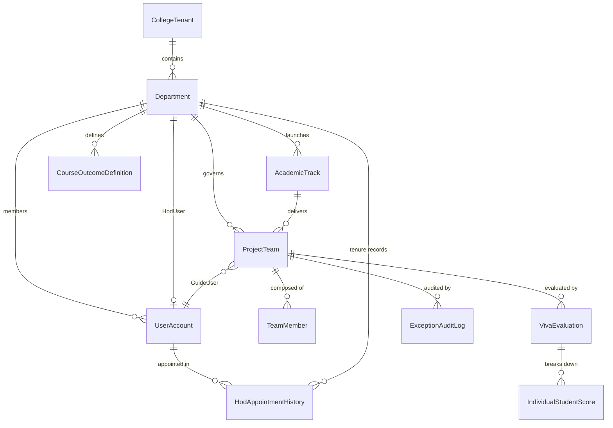

# COLABEX — HOD IMPLEMENTATION DISCOVERY

**Role Scope:** Head of Department (HOD) — Department-Level Academic Governance & Oversight  
**Tenant Context:** Multi-Tenant SaaS for Engineering Colleges (AICTE / NBA / RGPV Curriculum)  
**Date of Discovery:** November 2026  
**Auditor / Architect:** Principal SaaS Product Architect & Independent QA Lead  

---

## 1. EXECUTIVE SUMMARY

This discovery document details the current state of the Head of Department (HOD) module in Colabex. It maps all existing frontend screens, API endpoints, database entities, authorization gates, and data flows, identifying what is genuinely functional, what is synthetic or incomplete, and how HOD interfaces with the other four platform roles (Super Admin, College Admin, Faculty/Guide, Student).

---

## 2. FRONTEND ARCHITECTURE & SCREENS

### 2.1 Route Map & Route Registry
HOD routes are registered in `web/src/navigation/routeRegistry.ts` under the `"HOD"` role:

| Route Path | Label | Icon | Component / Page | Access Control |
|---|---|---|---|---|
| `/hod` | Overview | `LayoutDashboard` | `web/src/app/(dashboard)/hod/page.tsx` -> `<HODView initialTab="overview" />` | `Role == "HOD"` |
| `/hod/approvals` | Approvals Queue | `FileCheck2` | `web/src/app/(dashboard)/hod/approvals/page.tsx` -> `<HODView initialTab="approvals" />` | `Role == "HOD"`, badge: `pendingHODCount` |
| `/hod/nba` | NBA Criterion 2 & 3 | `GraduationCap` | `web/src/app/(dashboard)/hod/nba/page.tsx` -> `<HODView initialTab="nba" />` | `Role == "HOD"` |
| `/hod/faculty` | Faculty Setup | `Sliders` | `web/src/app/(dashboard)/hod/faculty/page.tsx` -> `<HODView initialTab="faculty" />` | `Role == "HOD"` |

### 2.2 Screen Implementation Details (`web/src/features/hod/HODView.tsx`)

#### Screen 1: Executive Overview (`/hod`)
- **Visual Elements:**
  - Department header banner showing active academic year and department title.
  - Track switcher pills (Minor Project Sem 6, Major Project Sem 8).
  - Launch Academic Track modal trigger button.
  - 4 KPI metric cards: Track Scope, Academic Track name, Pending Endorsements, Guide Capacity Balance.
  - Lifecycle Funnel: 6 pipeline stages (Draft, Guide Review, Coordinator, HOD Queue, Active Build, Completed).
  - Faculty Guide Workload distribution table with capacity progress bars.
- **Data Source in Code:**
  - Partially fetches `getAcademicContext()` and `getTracks()` from `hodApi`.
  - **Defect:** Pipeline funnel counts and percentages were hardcoded in JSX (`2, 3, 2, 1, 14, 2` for Minor, `3, 4, 3, 2, 18, 2` for Major).
  - **Defect:** Relied heavily on client-side mock store (`useProjectHubStore`) rather than real backend dashboard aggregates.
  - **Defect:** Actionable metric cards did not filter and navigate to corresponding project lists.

#### Screen 2: Approvals Queue (`/hod/approvals`)
- **Sub-Tabs:**
  - `allotments`: Proposals in `PendingHOD` state. Supports inspect drawer, single sign-off, return for revision modal with remarks, and bulk sign-off.
  - `proposals`: Pipeline overview displaying all pending proposals.
  - `unlocks`: Grade unlock requests from faculty for locked viva evaluations.
  - `overrides`: Mid-term administrative exception overrides submitted by Project Coordinator.
  - `results`: Tabulated student marksheet and letter grades.
- **Data Source in Code:**
  - Mock store (`useProjectHubStore`) was primary data provider in the component.
  - Results sub-tab displayed a hardcoded static array of 5 students (`0176CS221045`, `0176CS221002`, etc.) instead of calling `hodApi.getDepartmentResults()`.

#### Screen 3: NBA Criterion 2 & 3 (`/hod/nba`)
- **Visual Elements:**
  - Attestation status banner with "Attest & Lock Department SAR" action and "Package 3 Best + 3 Avg + 3 Weak ZIP" modal.
  - Direct + Indirect CO-PO Attainment Matrix (80/20 AICTE/NBA blend).
  - Multi-Year Department Project Archive table with search and batch filter.
- **Data Source in Code:**
  - Archive table contained hardcoded mock projects in JSX.
  - Export ZIP triggers backend endpoint `/api/hod/nba/export-zip`.

#### Screen 4: Faculty Setup (`/hod/faculty`)
- **Visual Elements:**
  - Department Faculty Roster table with inline capacity steppers (`+` / `-` max teams).
  - Project Coordinator toggle switch.
  - "+ Add Faculty Member" button triggering a user account creation modal.
- **Role Boundary Defect:**
  - "+ Add Faculty Member" duplicates College Admin staff directory onboarding (`/college/users`).

---

## 3. BACKEND CONTROLLER & ENDPOINTS (`backend/src/ProjectHub.Api/Controllers/HodController.cs`)

All endpoints are decorated with `[Authorize(Policy = ProjectHubPolicies.HodOnly)]`.

### 3.1 Endpoint Catalog

| HTTP Method | Route | Description | State Mutated | Audit Logged |
|---|---|---|---|---|
| `GET` | `/api/hod/dashboard` | Returns department summary metrics & NBA percentages | None | No |
| `GET` | `/api/hod/academic-context` | Returns department sessions, semester terms & offerings | None | No |
| `GET` | `/api/hod/tracks` | Lists academic tracks scoped to department/college | None | No |
| `POST` | `/api/hod/tracks` | Launches a new department academic track | `AcademicTrack`, `SemesterTerm`, `SubjectOffering` | Yes (EF Core) |
| `GET` | `/api/hod/proposals` | Lists project proposals in `PendingHOD` status | None | No |
| `POST` | `/api/hod/proposals/{teamId}/approve` | Approves proposal -> `ActiveBuild`, locks roster | `ProjectTeam` | **Missing** |
| `POST` | `/api/hod/proposals/{teamId}/endorse` | Alias for proposal approval | `ProjectTeam` | **Missing** |
| `POST` | `/api/hod/proposals/{teamId}/reject` | Returns proposal -> `Draft`, unlocks roster | `ProjectTeam` | **Missing** |
| `POST` | `/api/hod/proposals/{teamId}/return` | Alias for returning proposal | `ProjectTeam` | **Missing** |
| `POST` | `/api/hod/proposals/bulk-approve` | Bulk approves candidate proposals | `ProjectTeam` | **Yes** (`PlatformAuditLog`) |
| `GET` | `/api/hod/faculty` | Lists department faculty and current workload | None | No |
| `POST` | `/api/hod/faculty` | Provisions a new faculty user account | `UserAccount` | Yes (`PlatformAuditLog`) |
| `PUT` | `/api/hod/faculty/{facultyId}/coordinator` | Toggles Project Coordinator flag | `UserAccount` | No |
| `PUT` | `/api/hod/faculty/{facultyId}/mentor-cap` | Updates maximum mentor capacity | `UserAccount` | No |
| `GET` | `/api/hod/nba-attainment` | Returns calculated/fallback NBA attainment | None | No |
| `GET` | `/api/hod/nba/export-zip` | Streams ZIP dossier containing scorecards & artifacts | None | No |
| `GET` | `/api/hod/exceptions` | Lists governance exception audit logs | None | No |
| `POST` | `/api/hod/exceptions/{exceptionId}/approve` | Approves exception override | `ExceptionAuditLog` | No (didn't mutate team) |
| `POST` | `/api/hod/exceptions/{exceptionId}/reject` | Rejects exception override | `ExceptionAuditLog` | No |
| `GET` | `/api/hod/grade-unlocks` | Lists pending grade unlock requests | None | No |
| `POST` | `/api/hod/grade-unlocks/{id}/approve` | Unlocks viva evaluation (`IsLocked = false`) | `VivaEvaluation`, `ExceptionAuditLog` | Yes (`PlatformAuditLog`) |
| `POST` | `/api/hod/grade-unlocks/{id}/reject` | Rejects grade unlock request | `ExceptionAuditLog` | Yes (`PlatformAuditLog`) |
| `POST` | `/api/hod/sar/attest` | Attests department NBA SAR contribution | `Department` | Yes (`PlatformAuditLog`) |
| `GET` | `/api/hod/results` | Returns tabulated student marksheet | None | No |

---

## 4. DATABASE SCHEMA & PERSISTENCE

### 4.1 Relevant Entities & Relationships



1. **`Department` (`backend/src/ProjectHub.Domain/Entities/Department.cs`)**:
   - `Id`, `CollegeId`, `CourseProgramId`, `Code`, `Name`, `HodUserId`, `IntakeQuota`, `IsSarAttested`, `SarAttestedAtUtc`, `SarAttestedByUserId`.
   - Links directly to appointed HOD user via `HodUserId`.
2. **`HodAppointmentHistory` (`backend/src/ProjectHub.Domain/Entities/HodAppointmentHistory.cs`)**:
   - `Id`, `CollegeId`, `DepartmentId`, `HodUserId`, `AppointedByUserId`, `AppointedByName`, `AppointedAtUtc`, `RelievedAtUtc`, `IsCurrent`, `Remarks`.
   - Maintained by College Admin when appointing or replacing HODs.
3. **`AcademicTrack` (`backend/src/ProjectHub.Domain/Entities/AcademicTrack.cs`)**:
   - Continuous evaluation weights: `GuideWeightPct` (30), `MidTermWeightPct` (30), `FinalVivaWeightPct` (40) [Sum = 100%].
   - Rubric split: `SharedProjectRubricPct` (60), `IndividualStudentRubricPct` (40) [Sum = 100%].
4. **`ProjectTeam` (`backend/src/ProjectHub.Domain/Entities/ProjectTeam.cs`)**:
   - Statuses: `Draft`, `PendingGuide`, `PendingCoordinator`, `PendingHOD`, `ActiveBuild`, `AtRisk`, `ReadyForViva`, `Completed`, `Archived`.
   - Tracks guide via `GuideUserId`, roster lock via `IsRosterLocked`, log streaks via `MissedLogStreak`.
5. **`ExceptionAuditLog` (`backend/src/ProjectHub.Domain/Entities/ExceptionAuditLog.cs`)**:
   - Action types: `ReassignGuide`, `RemoveDroppedMember`, `AmendLockedRoster`, `IndividualReVivaUnlock`, `SingleStudentProvisioned`.
   - Holds previous/new state in `PreviousValueJson` and `NewValueJson`.
6. **`PlatformAuditLog` (`backend/src/ProjectHub.Domain/Entities/PlatformAuditLog.cs`)**:
   - Immutable audit trail capturing `ActorUserId`, `ActorEmail`, `Action`, `TargetTenantId`, `TargetEntity`, `MetadataJson`, `OccurredAtUtc`.

---

## 5. EXISTING AUTHORIZATION & TENANCY SCOPING

### 5.1 Authorization Policy
In `ProjectHubPolicies.cs`:
```csharp
options.AddPolicy(HodOnly, policy =>
    policy.RequireAssertion(ctx =>
        ctx.User.IsInRole(UserRole.HOD.ToString()) ||
        ctx.User.HasClaim("role", UserRole.HOD.ToString())));
```
This verifies that the user possesses the `HOD` role claim.

### 5.2 Department Scoping Flaw in `ResolveDepartmentIdAsync()`
In `HodController.cs`:
```csharp
if (_tenantContext.DepartmentId.HasValue && _tenantContext.DepartmentId.Value != Guid.Empty)
{
    var deptExists = await _context.Departments
        .AnyAsync(d => d.Id == _tenantContext.DepartmentId.Value && d.CollegeId == collegeId.Value && !d.IsDeleted);
    if (deptExists)
    {
        return _tenantContext.DepartmentId.Value;
    }
}
```
**CRITICAL VULNERABILITY IDENTIFIED:**
- The existing method checked only whether the requested `DepartmentId` existed within the college tenant.
- It did NOT verify whether the authenticated `userId` was actually the appointed HOD (`d.HodUserId == userId.Value`).
- An HOD from Department A could pass `DepartmentId = Department B` in the request header or claim and immediately gain governance authority over Department B!
- A relieved HOD whose token retained an old `department_id` could execute actions because the department still exists in the DB!

---

## 6. ROLE BOUNDARIES & INTER-ROLE DEPENDENCIES

| Domain Function | Super Admin | College Admin | HOD | Faculty / Guide | Student |
|---|---|---|---|---|---|
| Tenant / College Provisioning | **Owner** | None | None | None | None |
| Institution Accreditation Engine | Observer | **Owner** | Contributor | None | None |
| Department Creation & Quotas | None | **Owner** | None | None | None |
| HOD Appointment & Tenure | None | **Owner** | None | None | None |
| Staff Onboarding & Credentials | None | **Owner** | Read-Only Directory | None | None |
| Project Track Launching | None | Institutional | **Department Owner** | None | None |
| Proposal Review & Final Sign-Off | None | None | **Final Sign-Off** | Endorsement | Author |
| Guide Allocation & Workload Caps | None | None | **Department Governance** | Capacity Self-Check | Propose |
| Evaluation Rubric Scoring | None | None | Observer | **Scoring Owner** | None |
| Grade Unlock Authorization | None | None | **Authorization** | Requester | None |
| Sprint Tasks & Logbooks | None | None | Progress Monitoring | Reviewer / Verifier | **Owner** |

---

## 7. DISCOVERY CONCLUSION

The existing codebase provides a solid domain foundation: .NET 10 Web API with EF Core relational entities and Next.js 16 frontend with design system components. However, the HOD module suffered from:
1. Critical department authorization bypass via unvalidated `DepartmentId`.
2. Missing status checks in single proposal approval/return endpoints.
3. Unapplied state mutations in exception overrides (`ReassignGuide`).
4. Hardcoded synthetic metrics in dashboard, NBA attainment, and marksheet tables.
5. Incomplete UI integration where screens read from Zustand mock store rather than live backend APIs.
6. Absence of a dedicated Projects governance view and Reports view.
7. Duplication of College Admin HR onboarding in HOD screens.
