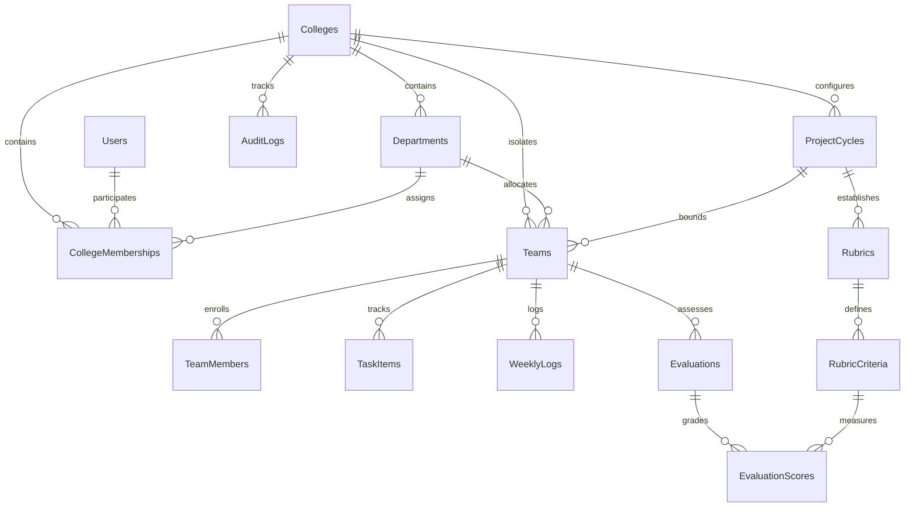

# Project Hub — Database Schema Blueprint

## 1. Multi-Tenant Relational Data Model

Every tenant entity maintains an immutable `CollegeId` (UUID) foreign key referencing `Colleges(Id)`. Tenant-scoped database queries apply automatic global query filters in Entity Framework Core 10.

---

## 2. Table Specifications

### 2.1 `Colleges` (Tenant Root Entity)
*Non-tenant root table managed by SuperAdmin.*

| Column | Type | Constraints | Description |
| :--- | :--- | :--- | :--- |
| `Id` | `UUID` | Primary Key, `gen_random_uuid()` | Unique tenant identifier |
| `Name` | `VARCHAR(250)` | NOT NULL | Official name of the college |
| `Code` | `VARCHAR(50)` | NOT NULL, UNIQUE | Institutional code (e.g. `BMSCE`, `RVCE`) |
| `Domain` | `VARCHAR(100)` | NOT NULL, UNIQUE | SSO email domain (e.g. `bmsce.ac.in`) |
| `LogoUrl` | `VARCHAR(500)` | NULL | Cloud storage URL to institutional logo |
| `IsActive` | `BOOLEAN` | NOT NULL, DEFAULT true | Tenant operational status |
| `SubscriptionPlan` | `VARCHAR(50)` | NOT NULL, DEFAULT 'Pilot' | License tier: `Pilot`, `Standard`, `Enterprise` |
| `SubscriptionExpiresAtUtc` | `TIMESTAMPTZ` | NULL | Expiration timestamp |
| `CreatedAtUtc` | `TIMESTAMPTZ` | NOT NULL | Creation timestamp |
| `UpdatedAtUtc` | `TIMESTAMPTZ` | NULL | Last modification timestamp |

---

### 2.2 `Departments`
*Tenant-scoped academic branch.*

| Column | Type | Constraints | Description |
| :--- | :--- | :--- | :--- |
| `Id` | `UUID` | Primary Key | Department identifier |
| `CollegeId` | `UUID` | NOT NULL, FK -> `Colleges(Id)` | Tenant partition |
| `Name` | `VARCHAR(150)` | NOT NULL | Branch name (e.g. Computer Science & Eng) |
| `Code` | `VARCHAR(20)` | NOT NULL | Branch code (e.g. `CSE`, `ECE`, `MECH`) |
| `HodUserId` | `UUID` | NULL, FK -> `Users(Id)` | Appointed HOD user account |
| `CreatedAtUtc` | `TIMESTAMPTZ` | NOT NULL | Timestamp |
| `UpdatedAtUtc` | `TIMESTAMPTZ` | NULL | Timestamp |

*Indexes:*
- `IX_Departments_CollegeId_Code` (UNIQUE on `CollegeId`, `Code`)

---

### 2.3 `Users` & `CollegeMemberships`

#### `Users` (Identity Record)
| Column | Type | Constraints | Description |
| :--- | :--- | :--- | :--- |
| `Id` | `UUID` | Primary Key | User identifier |
| `Email` | `VARCHAR(256)` | NOT NULL, UNIQUE | Institutional email address |
| `PasswordHash` | `VARCHAR(500)` | NULL | Salted Argon2id / Identity hash |
| `FirstName` | `VARCHAR(100)` | NOT NULL | First name |
| `LastName` | `VARCHAR(100)` | NOT NULL | Last name |
| `IsSuperAdmin` | `BOOLEAN` | NOT NULL, DEFAULT false | Startup team platform superadmin flag |
| `IsActive` | `BOOLEAN` | NOT NULL, DEFAULT true | Account status |
| `EmailConfirmed` | `BOOLEAN` | NOT NULL, DEFAULT false | Account verification flag |
| `CreatedAtUtc` | `TIMESTAMPTZ` | NOT NULL | Timestamp |

#### `CollegeMemberships` (Tenant Role & Context)
| Column | Type | Constraints | Description |
| :--- | :--- | :--- | :--- |
| `Id` | `UUID` | Primary Key | Membership identifier |
| `CollegeId` | `UUID` | NOT NULL, FK -> `Colleges(Id)` | Tenant partition |
| `UserId` | `UUID` | NOT NULL, FK -> `Users(Id)` | Associated user account |
| `DepartmentId` | `UUID` | NULL, FK -> `Departments(Id)` | Department (null for CollegeAdmin) |
| `Role` | `VARCHAR(30)` | NOT NULL | `CollegeAdmin`, `HOD`, `Faculty`, `Student` |
| `IsProjectCoordinator` | `BOOLEAN` | NOT NULL, DEFAULT false | Faculty coordinator privilege flag |
| `EnrollmentNumber` | `VARCHAR(50)` | NULL | USN / PRN / Roll Number for students |
| `EmployeeId` | `VARCHAR(50)` | NULL | Faculty institutional employee ID |
| `CreatedAtUtc` | `TIMESTAMPTZ` | NOT NULL | Timestamp |

*Indexes:*
- `IX_CollegeMemberships_CollegeId_UserId` (UNIQUE)
- `IX_CollegeMemberships_CollegeId_EnrollmentNumber` (Filtered where NOT NULL)

---

### 2.4 `ProjectCycles`
*Tenant-scoped academic cycle definition.*

| Column | Type | Constraints | Description |
| :--- | :--- | :--- | :--- |
| `Id` | `UUID` | Primary Key | Cycle identifier |
| `CollegeId` | `UUID` | NOT NULL, FK -> `Colleges(Id)` | Tenant partition |
| `DepartmentId` | `UUID` | NOT NULL, FK -> `Departments(Id)` | Academic branch |
| `AcademicYear` | `VARCHAR(20)` | NOT NULL | Format: `2025-2026` |
| `Type` | `VARCHAR(20)` | NOT NULL | `Minor` or `Major` |
| `Semester` | `INTEGER` | NOT NULL | 5 or 6 (Minor); 7 or 8 (Major) |
| `ProposalDeadlineUtc` | `TIMESTAMPTZ` | NOT NULL | Submission lock cutoff |
| `IsActive` | `BOOLEAN` | NOT NULL, DEFAULT true | Current active cycle flag |
| `MaxTeamSize` | `INTEGER` | NOT NULL, DEFAULT 4 | Maximum team size |
| `MinTeamSize` | `INTEGER` | NOT NULL, DEFAULT 2 | Minimum team size |
| `CreatedAtUtc` | `TIMESTAMPTZ` | NOT NULL | Timestamp |

---

### 2.5 `Teams` & `TeamMembers`

#### `Teams`
| Column | Type | Constraints | Description |
| :--- | :--- | :--- | :--- |
| `Id` | `UUID` | Primary Key | Team identifier |
| `CollegeId` | `UUID` | NOT NULL, FK -> `Colleges(Id)` | Tenant partition |
| `CycleId` | `UUID` | NOT NULL, FK -> `ProjectCycles(Id)` | Associated project cycle |
| `DepartmentId` | `UUID` | NOT NULL, FK -> `Departments(Id)` | Department partition |
| `TeamCode` | `VARCHAR(50)` | NOT NULL | Human-readable code: `2026-CS-MAJ-01` |
| `Title` | `VARCHAR(300)` | NOT NULL | Project title |
| `Abstract` | `TEXT` | NOT NULL | Synopsis / problem statement |
| `Domain` | `VARCHAR(100)` | NOT NULL | Topic domain: AI, Web, Cloud, etc. |
| `GuideUserId` | `UUID` | NULL, FK -> `Users(Id)` | Assigned Faculty Guide |
| `State` | `VARCHAR(30)` | NOT NULL | `Draft`, `PendingGuide`, `PendingCoordinator`, `PendingHOD`, `Active`, `Completed` |
| `GitHubRepoUrl` | `VARCHAR(500)` | NULL | Linked repository URL |
| `JiraProjectUrl` | `VARCHAR(500)` | NULL | Linked issue tracker URL |
| `IsRosterLocked` | `BOOLEAN` | NOT NULL, DEFAULT false | Whether team membership is frozen |
| `CreatedAtUtc` | `TIMESTAMPTZ` | NOT NULL | Timestamp |
| `UpdatedAtUtc` | `TIMESTAMPTZ` | NULL | Timestamp |

#### `TeamMembers`
| Column | Type | Constraints | Description |
| :--- | :--- | :--- | :--- |
| `Id` | `UUID` | Primary Key | Record identifier |
| `CollegeId` | `UUID` | NOT NULL, FK -> `Colleges(Id)` | Tenant partition |
| `TeamId` | `UUID` | NOT NULL, FK -> `Teams(Id)` | Associated team |
| `UserId` | `UUID` | NOT NULL, FK -> `Users(Id)` | Student member |
| `IsLead` | `BOOLEAN` | NOT NULL, DEFAULT false | Contextual `TeamLead` badge flag |
| `JoinedAtUtc` | `TIMESTAMPTZ` | NOT NULL | Join timestamp |

*Indexes:*
- `IX_Teams_CollegeId_TeamCode` (UNIQUE)
- `IX_TeamMembers_CollegeId_TeamId_UserId` (UNIQUE)

---

### 2.6 `TaskItems` & `WeeklyLogs`

#### `TaskItems` (Milestone / Sprint Tasks)
| Column | Type | Constraints | Description |
| :--- | :--- | :--- | :--- |
| `Id` | `UUID` | Primary Key | Task identifier |
| `CollegeId` | `UUID` | NOT NULL, FK -> `Colleges(Id)` | Tenant partition |
| `TeamId` | `UUID` | NOT NULL, FK -> `Teams(Id)` | Project team |
| `Title` | `VARCHAR(200)` | NOT NULL | Task summary |
| `Description` | `TEXT` | NULL | Detailed specifications |
| `AssigneeId` | `UUID` | NULL, FK -> `Users(Id)` | Assigned student |
| `Status` | `VARCHAR(30)` | NOT NULL | `Todo`, `InProgress`, `InReview`, `Done` |
| `DueDateUtc` | `TIMESTAMPTZ` | NULL | Milestone deadline |
| `CreatedAtUtc` | `TIMESTAMPTZ` | NOT NULL | Timestamp |

#### `WeeklyLogs` (Guide Sign-Off Logbook)
| Column | Type | Constraints | Description |
| :--- | :--- | :--- | :--- |
| `Id` | `UUID` | Primary Key | Log identifier |
| `CollegeId` | `UUID` | NOT NULL, FK -> `Colleges(Id)` | Tenant partition |
| `TeamId` | `UUID` | NOT NULL, FK -> `Teams(Id)` | Project team |
| `StudentId` | `UUID` | NOT NULL, FK -> `Users(Id)` | Submitting student |
| `WeekNumber` | `INTEGER` | NOT NULL | Semester week (1 through 16) |
| `Accomplishments` | `TEXT` | NOT NULL | Work completed this week |
| `Blockers` | `TEXT` | NULL | Impediments or hardware shortages |
| `PlannedNextWeek` | `TEXT` | NOT NULL | Upcoming deliverables |
| `GuideStatus` | `VARCHAR(30)` | NOT NULL | `Pending`, `Approved`, `NeedsRevision` |
| `GuideRemarks` | `TEXT` | NULL | Faculty mentor feedback |
| `ReviewedAtUtc` | `TIMESTAMPTZ` | NULL | Review timestamp |
| `CreatedAtUtc` | `TIMESTAMPTZ` | NOT NULL | Submission timestamp |

---

### 2.7 `Rubrics`, `RubricCriteria`, `Evaluations`, `EvaluationScores`

#### `Rubrics`
| Column | Type | Constraints | Description |
| :--- | :--- | :--- | :--- |
| `Id` | `UUID` | Primary Key | Rubric identifier |
| `CollegeId` | `UUID` | NOT NULL, FK -> `Colleges(Id)` | Tenant partition |
| `CycleId` | `UUID` | NOT NULL, FK -> `ProjectCycles(Id)` | Associated academic cycle |
| `Title` | `VARCHAR(150)` | NOT NULL | e.g. `Phase-1 Mid Review Rubric` |
| `Stage` | `VARCHAR(50)` | NOT NULL | `ProposalReview`, `MidTermReview`, `FinalViva` |
| `TotalMarks` | `DECIMAL(5,2)` | NOT NULL | Maximum aggregate marks |

#### `RubricCriteria` (NBA Mapping)
| Column | Type | Constraints | Description |
| :--- | :--- | :--- | :--- |
| `Id` | `UUID` | Primary Key | Criterion identifier |
| `CollegeId` | `UUID` | NOT NULL, FK -> `Colleges(Id)` | Tenant partition |
| `RubricId` | `UUID` | NOT NULL, FK -> `Rubrics(Id)` | Associated rubric |
| `Name` | `VARCHAR(150)` | NOT NULL | e.g. `System Architecture & Design` |
| `Description` | `TEXT` | NULL | Benchmark descriptions |
| `MaxScore` | `DECIMAL(5,2)` | NOT NULL | Max marks for this criterion |
| `NbaCriterionCode` | `VARCHAR(20)` | NOT NULL | e.g. `PO3`, `PO4`, `PSO1` |
| `BloomsTaxonomyLevel` | `VARCHAR(20)` | NOT NULL | `L1_Remember` to `L6_Create` |

#### `Evaluations`
| Column | Type | Constraints | Description |
| :--- | :--- | :--- | :--- |
| `Id` | `UUID` | Primary Key | Evaluation identifier |
| `CollegeId` | `UUID` | NOT NULL, FK -> `Colleges(Id)` | Tenant partition |
| `TeamId` | `UUID` | NOT NULL, FK -> `Teams(Id)` | Evaluated team |
| `RubricId` | `UUID` | NOT NULL, FK -> `Rubrics(Id)` | Applied rubric |
| `EvaluatorUserId` | `UUID` | NOT NULL, FK -> `Users(Id)` | Faculty panelist |
| `IsFinalized` | `BOOLEAN` | NOT NULL, DEFAULT false | Whether scores are locked |
| `EvaluatedAtUtc` | `TIMESTAMPTZ` | NOT NULL | Timestamp |

#### `EvaluationScores`
| Column | Type | Constraints | Description |
| :--- | :--- | :--- | :--- |
| `Id` | `UUID` | Primary Key | Score identifier |
| `CollegeId` | `UUID` | NOT NULL, FK -> `Colleges(Id)` | Tenant partition |
| `EvaluationId` | `UUID` | NOT NULL, FK -> `Evaluations(Id)` | Parent evaluation |
| `CriterionId` | `UUID` | NOT NULL, FK -> `RubricCriteria(Id)`| Measured criterion |
| `StudentId` | `UUID` | NULL, FK -> `Users(Id)` | Specific student (or null if team-wide) |
| `AwardedScore` | `DECIMAL(5,2)` | NOT NULL | Awarded marks |
| `Feedback` | `TEXT` | NULL | Individual evaluator feedback |

---

### 2.8 `AuditLogs` (Immutable Record)
*Every INSERT, UPDATE, and DELETE across tenant entities is intercepted and recorded.*

| Column | Type | Constraints | Description |
| :--- | :--- | :--- | :--- |
| `Id` | `BIGSERIAL` | Primary Key | Auto-incrementing log ID |
| `CollegeId` | `UUID` | NULL, FK -> `Colleges(Id)` | Tenant identifier (nullable for platform events) |
| `UserId` | `UUID` | NULL | Acting user ID |
| `UserEmail` | `VARCHAR(256)` | NULL | Acting user email |
| `EntityName` | `VARCHAR(100)` | NOT NULL | C# Entity class name |
| `EntityId` | `VARCHAR(100)` | NOT NULL | Stringified primary key |
| `Action` | `VARCHAR(20)` | NOT NULL | `Insert`, `Update`, `Delete` |
| `ChangesJson` | `JSONB` | NOT NULL | Changed properties and diff |
| `IpAddress` | `VARCHAR(50)` | NULL | Request IP address |
| `TimestampUtc` | `TIMESTAMPTZ` | NOT NULL | UTC timestamp |

*Indexes:*
- `IX_AuditLogs_CollegeId_TimestampUtc`
- `IX_AuditLogs_EntityName_EntityId`

