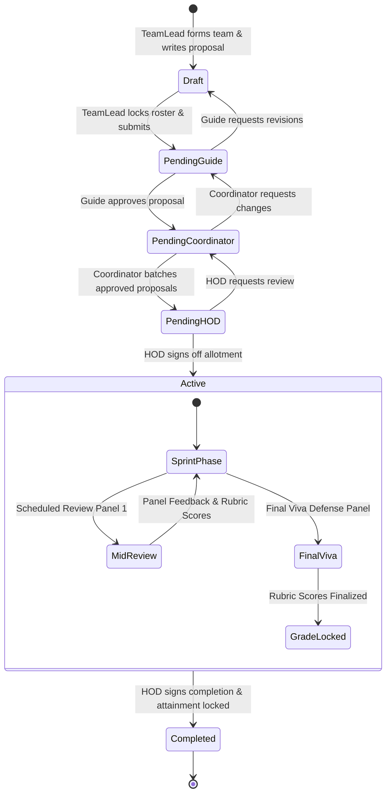

# Project Hub — Product Architecture Blueprint

## 1. System Vision & Domain Boundaries
Project Hub is an institutional B2B SaaS platform engineered specifically for engineering colleges accredited by or preparing for the National Board of Accreditation (NBA). The platform automates academic project workflows for **Minor Projects (Year 3 / Semesters 5-6)** and **Major Projects (Year 4 / Semesters 7-8)** while producing direct digital evidence dossiers for **NBA Criteria 2 (Teaching-Learning Practices) and 3 (Course Outcomes & Program Attainment)**.

---

## 2. Complete Role-Permission Matrix

| Capability / Action | SuperAdmin | CollegeAdmin | HOD | Coordinator (Faculty) | Guide (Faculty) | Evaluator (Faculty) | Student | TeamLead (Student) |
| :--- | :---: | :---: | :---: | :---: | :---: | :---: | :---: | :---: |
| **Tenant Provisioning & Global Config** | ✅ | ❌ | ❌ | ❌ | ❌ | ❌ | ❌ | ❌ |
| **Manage Pilot / Subscriptions** | ✅ | ❌ | ❌ | ❌ | ❌ | ❌ | ❌ | ❌ |
| **Global NBA/SDG Taxonomy Templates** | ✅ | ❌ | ❌ | ❌ | ❌ | ❌ | ❌ | ❌ |
| **View Internal Student Marks** | ❌ *(Strict Zero)* | ❌ | ✅ | ✅ | ✅ | ✅ | Self Only | Self Only |
| **Create Branches / Departments** | ❌ | ✅ | ❌ | ❌ | ❌ | ❌ | ❌ | ❌ |
| **Appoint Department HODs** | ❌ | ✅ | ❌ | ❌ | ❌ | ❌ | ❌ | ❌ |
| **College Branding & SSO Config** | ❌ | ✅ | ❌ | ❌ | ❌ | ❌ | ❌ | ❌ |
| **Cross-Department Analytics** | ❌ | ✅ | ❌ | ❌ | ❌ | ❌ | ❌ | ❌ |
| **Toggle Faculty Coordinator Flag** | ❌ | ❌ | ✅ | ❌ | ❌ | ❌ | ❌ | ❌ |
| **Sign-Off Project Allotments** | ❌ | ❌ | ✅ | ❌ | ❌ | ❌ | ❌ | ❌ |
| **Approve Post-Lock Grade Unlocks** | ❌ | ❌ | ✅ | ❌ | ❌ | ❌ | ❌ | ❌ |
| **Export Signed NBA Dossier (Crit 2 & 3)** | ❌ | ❌ | ✅ | ✅ | ❌ | ❌ | ❌ | ❌ |
| **Manage Cycles & Rubrics** | ❌ | ❌ | ✅ | ✅ | ❌ | ❌ | ❌ | ❌ |
| **Bulk Import Student/Faculty CSV** | ❌ | ✅ | ❌ | ✅ | ❌ | ❌ | ❌ | ❌ |
| **Schedule Viva / Review Panels** | ❌ | ❌ | ❌ | ✅ | ❌ | ❌ | ❌ | ❌ |
| **Review Assigned Team Proposals** | ❌ | ❌ | ❌ | ❌ | ✅ | ❌ | ❌ | ❌ |
| **Review & Approve Weekly Logs** | ❌ | ❌ | ❌ | ❌ | ✅ | ❌ | ❌ | ❌ |
| **Grade Review / Viva Panels** | ❌ | ❌ | ❌ | ❌ | ❌ | ✅ | ❌ | ❌ |
| **Form Project Team & Invite Members**| ❌ | ❌ | ❌ | ❌ | ❌ | ❌ | ❌ | ✅ |
| **Lock Team Roster & Submit Proposal**| ❌ | ❌ | ❌ | ❌ | ❌ | ❌ | ❌ | ✅ |
| **Link Team GitHub / Jira Repositories**| ❌ | ❌ | ❌ | ❌ | ❌ | ❌ | ❌ | ✅ |
| **Submit Weekly Logs & Tasks** | ❌ | ❌ | ❌ | ❌ | ❌ | ❌ | ✅ | ✅ |
| **View Project Workspace & Portfolio** | ❌ | ❌ | ❌ | ❌ | ❌ | ❌ | ✅ | ✅ |

---

## 3. Role-Based Navigation Shell Breakdown

### 1. `SuperAdmin`
- **Tenants:** Active college tenants, pilot expirations, database usage.
- **Global NBA:** PO/PSO master taxonomies, Bloom's Taxonomy templates, UN SDG maps.
- **Subscriptions:** Billing status, licensed student quotas.
- **Audit:** Platform-level security and tenant access logs.

### 2. `CollegeAdmin`
- **Overview:** College-wide project metrics, student enrollment totals, NBA progress.
- **Departments:** Branch list, HOD assignments, intake capacities.
- **Branding & SSO:** College logo, subdomain, Google/Microsoft Azure AD configuration.
- **Audit Logs:** Institutional data exports, administrative actions.

### 3. `HOD`
- **Department Dashboard:** Minor & Major project distribution, guide workload distribution.
- **Allotments:** Pending proposals requiring HOD final sign-off.
- **Faculty Directory:** Faculty list with `ProjectCoordinator` toggle switches.
- **NBA Criterion 2 & 3:** CO-PO attainment calculation engine, signed audit exports.
- **Exceptions:** Post-lock grade unlock approval queue.

### 4. `Faculty`
- **Guide Teams:** Assigned teams, milestone tracking, weekly log approvals.
- **Evaluator Panels:** Scheduled review panels, viva scoring sheets, rubric evaluations.
- **Batch Ops (Coordinator Only):**
  - *Academic Cycles:* Minor/Major project cycle timelines and milestone dates.
  - *Rosters & CSV:* Bulk student import and team formation rules.
  - *Panel Scheduling:* Panel creation and guide conflict-of-interest prevention.
  - *NBA Rubric Builder:* Mapping rubric criteria to Program Outcomes (POs).
- **Profile:** Department affiliation, guide capacity preferences.

### 5. `Student` (Exactly 4 Permanent Tabs)
- **1. `Workspace`:**
  - Team roster and member statuses.
  - Milestone roadmap and sprint tasks.
  - Weekly log submission form and guide feedback.
  - *Team Lead Controls:* Send invites, lock roster, submit proposal, repository links.
- **2. `Explore`:**
  - Department repository of past approved projects, abstracts, and reference repositories.
  - Domain filters (AI/ML, IoT, Cloud, Embedded, etc.).
- **3. `Portfolio`:**
  - Student verified digital project transcript with verifiable QR code.
  - Demonstrated competencies, PO achievements, and approved certificates.
- **4. `Profile`:**
  - Academic credentials (Enrollment USN/PRN, Department, Semester).
  - GitHub/LinkedIn profile connections, notification preferences.

---

## 4. Project Lifecycle State Machine

### State Definitions & Enforcements:
1. **`Draft`:** TeamLead selects team members; edits title, abstract, domain, and proposed guide. Unrestricted edits.
2. **`PendingGuide`:** Team roster locked. Guide receives notification. Guide can either reject with feedback (reverts to `Draft`) or approve.
3. **`PendingCoordinator`:** Coordinator verifies eligibility, workload balance, and equipment requirements. Can request adjustments or endorse to HOD batch.
4. **`PendingHOD`:** HOD executes institutional sign-off on the batch allotment.
5. **`Active`:** Project is formally registered. GitHub/Jira activity tracking and weekly log submissions commence.
6. **`Completed`:** All viva evaluations concluded, grades signed, and NBA Course Outcome attainments calculated.

