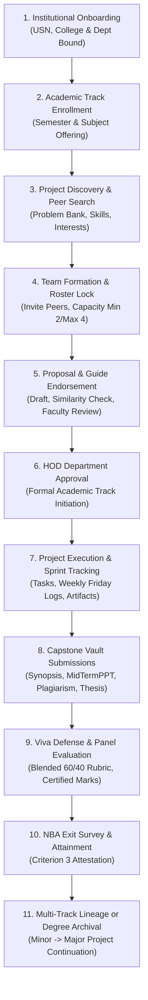
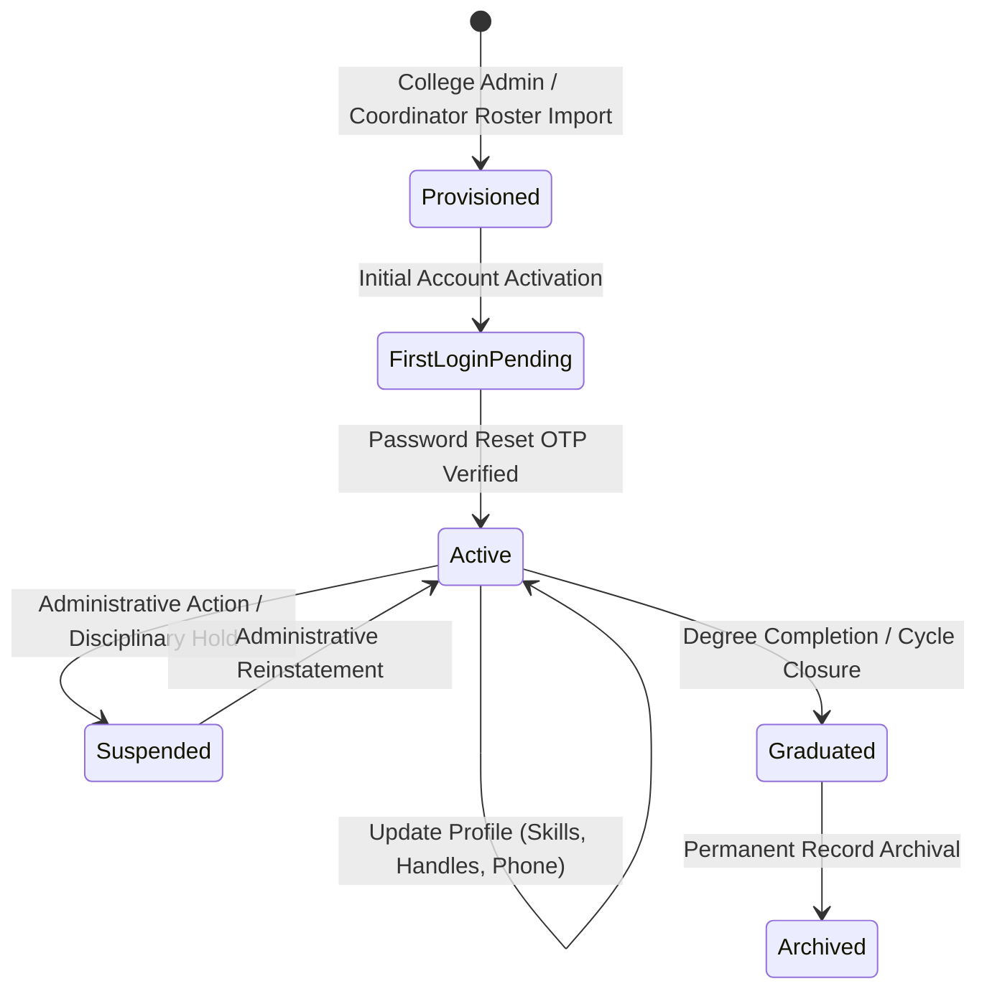
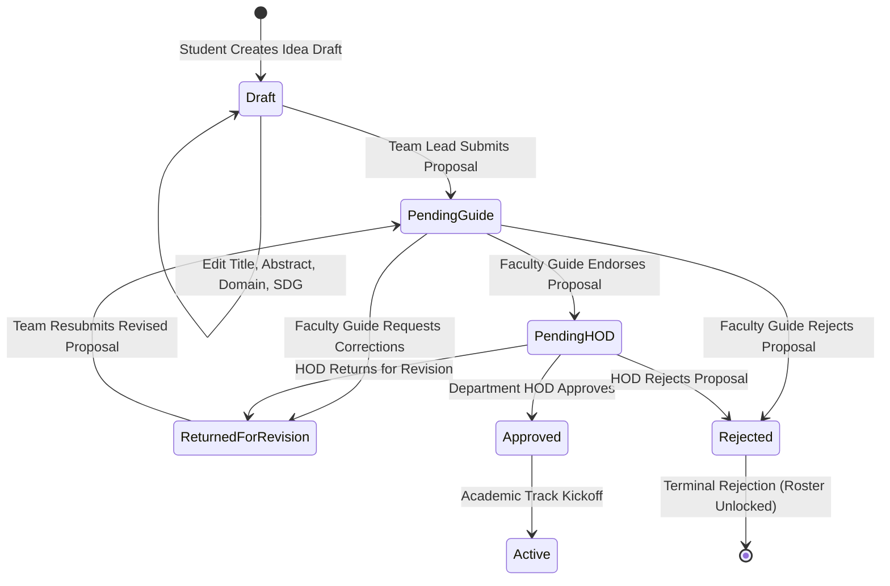
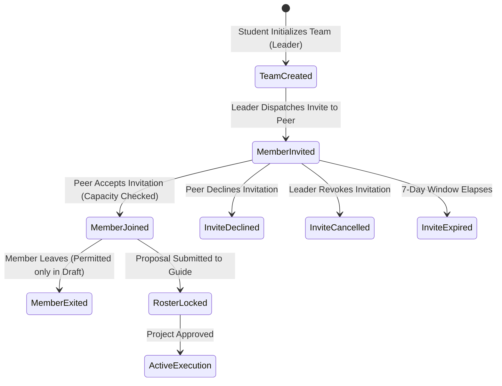
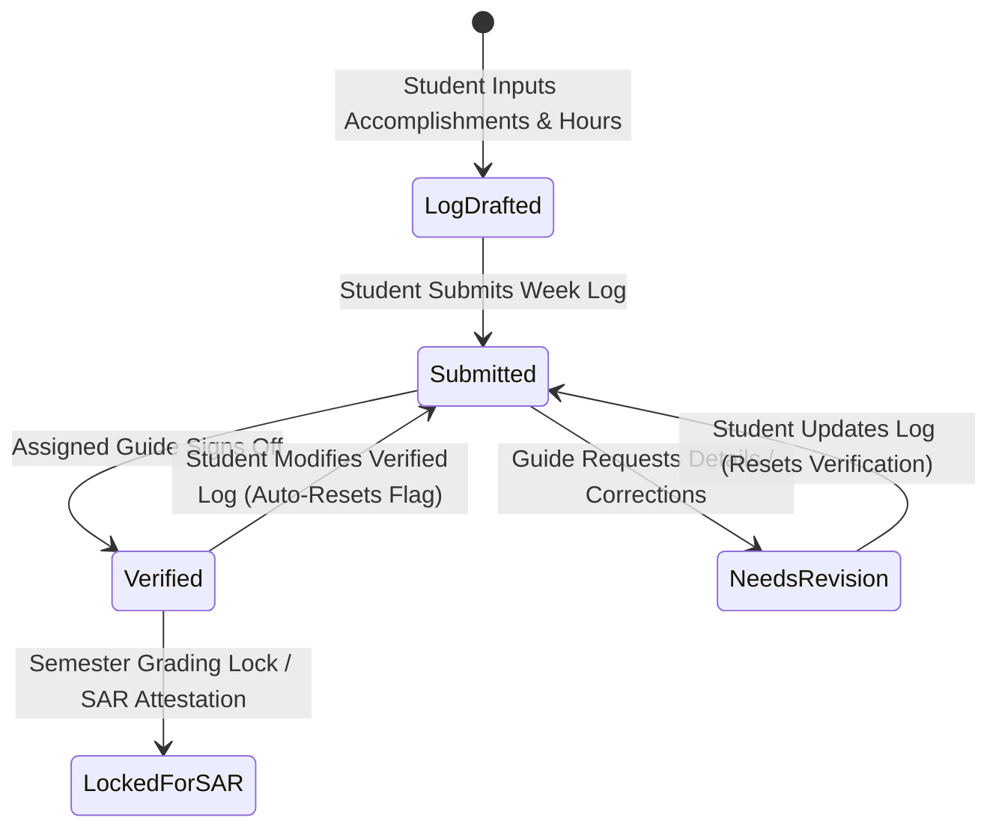
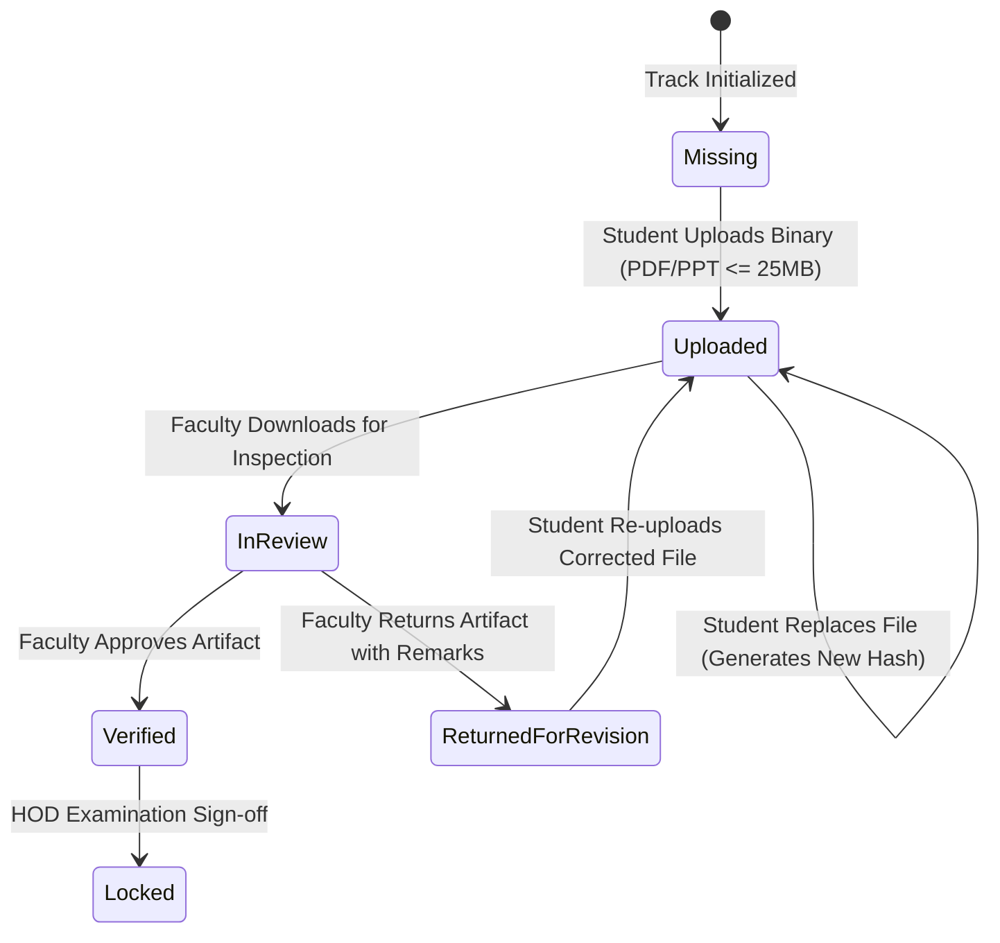
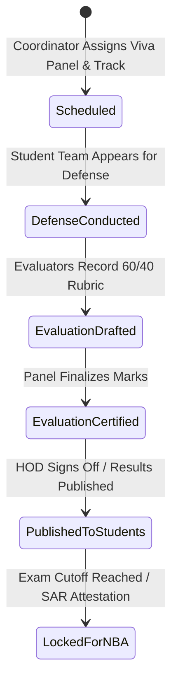

# COLABEX — STUDENT MODULE
# DELIVERABLE 3: ACADEMIC LIFECYCLE & STATE MACHINES
**Phase 1: Complete System Audit, Academic Lifecycle Discovery & Implementation Blueprint**
**Date:** November 24, 2026  
**Scope:** Formal State Machine Specifications for All Student Domain Lifecycles  

---

## 1. COMPREHENSIVE ACADEMIC LIFECYCLE OVERVIEW

In the Colabex ecosystem, an engineering student's journey spans from institutional onboarding through multi-semester capstone engineering, evaluation, and permanent credential archival.

---

## 2. INDIVIDUAL STATE MACHINES

### 2.1 Student Account Lifecycle State Machine
Governs student institutional identity in `UserAccounts`:

- **States:** `Provisioned`, `FirstLoginPending`, `Active`, `Suspended`, `Graduated`, `Archived`.
- **Verified Existing Implementation:** `UserAccounts.IsActive`, `UserAccounts.IsActivated`, `AuthController.cs`.
- **Proposed Future States:** `FirstLoginPending`, `Graduated`, `Archived`.

---

### 2.2 Project Idea & Proposal Lifecycle State Machine
Governs team proposal creation, revision, and academic endorsement:

- **Current Repository Status:**
  - `ProjectStatus` enum values: `Draft`, `PendingGuide`, `PendingHOD`, `Approved`, `Active`, `NeedsRevision`, `Rejected`, `Completed`.
  - `FacultyController.cs` implements `proposals/{id}/endorse`, `return`, `reject`.
  - `HodController.cs` implements `proposals/{id}/approve`, `reject`, `return`.
  - **GAP:** Student proposal submission (`Draft` -> `PendingGuide`) and resubmission are missing from `StudentController.cs` (Phase 3 task).

---

### 2.3 Team Formation & Invitation Lifecycle State Machine
Governs collaborative student team assembly:

- **Invariants & Transition Rules:**
  - **Min Team Size:** 2 (for team-mode tracks).
  - **Max Team Size:** 4.
  - **Locking Invariant:** Once proposal moves to `PendingGuide`, `IsRosterLocked = true`. No invitations, joins, or exits permitted.
  - **Concurrency Invariant:** Database transaction with row-level locks guarantees that two peers accepting simultaneously cannot exceed capacity.

---

### 2.4 Weekly Sprint Logbook Lifecycle State Machine
Governs continuous evaluation and Friday discipline tracking:

- **Verified Existing Implementation:**
  - `StudentController.cs` (`SubmitLogbook`): Submits or updates logbook; line 225 explicitly sets `existing.IsVerified = false;`.
  - `FacultyController.cs` (`VerifyLog`): Mentor signs off with remarks and timestamp.

---

### 2.5 Capstone Vault Deliverable Lifecycle State Machine
Governs artifact uploads across the 4 standard slots (`Synopsis`, `MidTermPPT`, `PlagiarismReport`, `FinalThesis`):

- **Verified Existing Implementation:**
  - `ArtifactSlotType` (4 slots), `ArtifactStatus` (`Missing`, `Uploaded`, `InReview`, `Verified`, `Returned`, `Rejected`).
  - `StudentController.cs` (`UploadArtifactBinary`): Enforces size and extension, computes SHA-256, resets `ReviewerNote = null`.
  - `FacultyController.cs` (`ReviewArtifact`): Sets status and reviewer notes.

---

### 2.6 Viva Defense & Examination Evaluation State Machine
Governs final academic grading:

- **Confidentiality Rule:** Students can view evaluation marks ONLY after state transitions to `PublishedToStudents`.
- **Existing Implementation:** Evaluator submission in `FacultyController.cs`, marksheet certification in `CollegeController.cs`.
- **GAP:** Student-facing `GET /api/student/evaluation` endpoint is missing (Phase 7 task).
