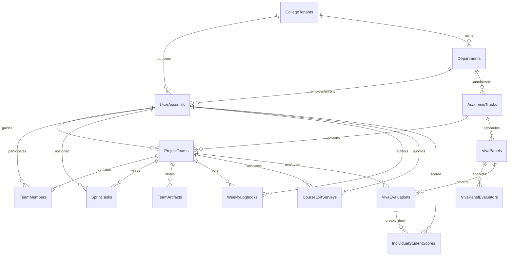

# COLABEX — STUDENT MODULE
# DELIVERABLE 5: DATABASE & DATA MODEL SPECIFICATION
**Phase 1: Complete System Audit, Academic Lifecycle Discovery & Implementation Blueprint**
**Date:** November 24, 2026  
**Database Provider:** PostgreSQL 17 LTS / EF Core 10  
**Scope:** Current Relational Schema Audit, Indexes, Concurrency Tokens & Proposed Schema Extensions  

---

## 1. EXISTING RELEVANT RELATIONAL SCHEMA AUDIT

The current database schema (verified in `ProjectHubDbContext.cs`, `ProjectHubDbContextModelSnapshot.cs`, and `Configurations/`) defines the following core tables relevant to the Student persona:



### 1.1 Existing Student Tables & Entity Configurations

#### `UserAccounts` (Table: `"UserAccounts"`)
- **Key Columns:** `Id` (UUID PK), `CollegeId` (UUID FK), `DepartmentId` (UUID FK, Nullable), `FullName` (VARCHAR 150), `Email` (VARCHAR 256), `EnrollmentOrEmployeeCode` (VARCHAR 50), `Role` (VARCHAR 50, Enum `UserRole`), `PasswordHash`, `IsActivated`, `IsActive`, `GitHubHandle`, `JiraKey`, `SkillsCsv`, `PhoneNumber`.
- **Indexes:**
  - Unique Filtered: `IX_UserAccounts_CollegeId_Email` where `"IsDeleted" = false`
  - Unique Filtered: `IX_UserAccounts_CollegeId_EnrollmentOrEmployeeCode` where `"IsDeleted" = false`
- **Tenant Isolation:** Double-Lock: EF Core Global Filter + PostgreSQL RLS (`ENABLE & FORCE ROW LEVEL SECURITY`).

#### `StudentAcademicEnrollments` (Table: `"StudentAcademicEnrollments"`)
- **Key Columns:** `Id` (UUID PK), `CollegeId` (UUID FK), `StudentUserId` (UUID FK), `CourseProgramId` (UUID FK), `DepartmentId` (UUID FK), `CurrentSemesterTermId` (UUID FK), `AdmissionBatch` (VARCHAR 50), `AcademicStatus` (VARCHAR 30, Enum `AcademicStatus`).
- **Indexes:** Unique Filtered: `IX_StudentAcademicEnrollments_CollegeId_StudentUserId_CurrentSemesterTermId` where `"IsDeleted" = false`.

#### `ProjectTeams` (Table: `"ProjectTeams"`)
- **Key Columns:** `Id` (UUID PK), `CollegeId` (UUID FK), `DepartmentId` (UUID FK), `AcademicTrackId` (UUID FK), `GuideUserId` (UUID FK, Nullable), `ParentProjectTeamId` (UUID FK, Nullable), `ProjectLineageId` (UUID), `TeamCode` (VARCHAR 50), `Title` (VARCHAR 300), `Abstract` (VARCHAR 2000), `DomainTag` (VARCHAR 100), `SdgCode` (VARCHAR 20), `Status` (VARCHAR 50, Enum `ProjectStatus`), `SimilarityScorePct` (NUMERIC 5,2), `RepoUrl`, `JiraBoardKey`, `IsRosterLocked` (BOOLEAN).
- **Indexes:**
  - Unique Filtered: `IX_ProjectTeams_CollegeId_AcademicTrackId_TeamCode` where `"IsDeleted" = false`
  - Trigram GIN Index: `IX_ProjectTeams_Title_Trgm` on `"Title" gin_trgm_ops`
  - Lineage Index: `IX_ProjectTeams_CollegeId_ProjectLineageId`
  - Aggregation Index: `IX_ProjectTeams_CollegeId_DepartmentId_AcademicTrackId_Status`
- **Concurrency Token:** PostgreSQL `xmin` system column mapped in `ProjectHubDbContext.cs` line 114.

#### `TeamMembers` (Table: `"TeamMembers"`)
- **Key Columns:** `Id` (UUID PK), `CollegeId` (UUID FK), `ProjectTeamId` (UUID FK), `UserId` (UUID FK), `IsTeamLead` (BOOLEAN), `ModuleResponsibility` (VARCHAR 250), `IsActive` (BOOLEAN).
- **Indexes:** Unique Filtered: `IX_TeamMembers_CollegeId_ProjectTeamId_UserId` where `"IsDeleted" = false`.

#### `SprintTasks` (Table: `"SprintTasks"`)
- **Key Columns:** `Id` (UUID PK), `CollegeId` (UUID FK), `ProjectTeamId` (UUID FK), `Title` (VARCHAR 200), `CategoryTag` (VARCHAR 50), `AssignedToUserId` (UUID FK, Nullable), `Status` (VARCHAR 30, Enum `SprintTaskStatus`), `DueDateUtc` (TIMESTAMPTZ, Nullable).
- **Foreign Keys:** Cascade delete on `ProjectTeamId`.

#### `TeamArtifacts` (Table: `"TeamArtifacts"`)
- **Key Columns:** `Id` (UUID PK), `CollegeId` (UUID FK), `ProjectTeamId` (UUID FK), `SlotType` (VARCHAR 50, Enum `ArtifactSlotType`), `FileName` (VARCHAR 255), `StorageKey` (VARCHAR 500), `Sha256Checksum` (VARCHAR 64), `FileSizeBytes` (BIGINT), `Status` (VARCHAR 50, Enum `ArtifactStatus`), `UploadedByUserId` (UUID), `ReviewerNote` (TEXT, Nullable).
- **Indexes:** Unique Filtered: `IX_TeamArtifacts_CollegeId_ProjectTeamId_SlotType` where `"IsDeleted" = false`.

#### `WeeklyLogbooks` (Table: `"WeeklyLogbooks"`)
- **Key Columns:** `Id` (UUID PK), `CollegeId` (UUID FK), `ProjectTeamId` (UUID FK), `AuthorUserId` (UUID FK), `WeekNumber` (INT), `AccomplishmentsSummary` (TEXT), `BlockersSummary` (TEXT, Nullable), `HoursLogged` (NUMERIC 5,2), `GitCommitCount` (INT), `IsVerified` (BOOLEAN), `MentorRemarks` (TEXT, Nullable).
- **Indexes:** Unique Filtered: `IX_WeeklyLogbooks_CollegeId_ProjectTeamId_AuthorUserId_WeekNumber` where `"IsDeleted" = false`.

#### `CourseExitSurveys` (Table: `"CourseExitSurveys"`)
- **Key Columns:** `Id` (UUID PK), `CollegeId` (UUID FK), `ProjectTeamId` (UUID FK), `StudentUserId` (UUID FK), `PoRatingsJson` (TEXT), `SubmittedAtUtc` (TIMESTAMPTZ).
- **Indexes:** Unique Filtered: `IX_CourseExitSurveys_CollegeId_ProjectTeamId_StudentUserId` where `"IsDeleted" = false`.

---

## 2. PROPOSED SCHEMA EXTENSIONS FOR STUDENT MODULE

To support collaborative team formation, academic milestones, and notifications without breaking existing schema, the following new tables are proposed for addition via EF Core migrations in future phases:

### 2.1 Proposed Entity: `TeamInvitation` (Phase 4)
```csharp
public class TeamInvitation : BaseEntity, ITenantEntity
{
    public Guid CollegeId { get; set; }
    public Guid ProjectTeamId { get; set; }
    public Guid InvitedStudentUserId { get; set; }
    public Guid InvitedByUserId { get; set; }
    public InvitationStatus Status { get; set; } = InvitationStatus.Pending;
    public string? Message { get; set; }
    public DateTime ExpiresAtUtc { get; set; }
    public DateTime? RespondedAtUtc { get; set; }

    // Navigations
    public CollegeTenant? College { get; set; }
    public ProjectTeam? ProjectTeam { get; set; }
    public UserAccount? InvitedStudentUser { get; set; }
    public UserAccount? InvitedByUser { get; set; }
}
```
- **Indexes:**
  - `IX_TeamInvitations_CollegeId_ProjectTeamId_InvitedStudentUserId_Status` (Enforces 1 active pending invitation per student per team).
- **PostgreSQL RLS:** `ENABLE & FORCE ROW LEVEL SECURITY` with `tenant_isolation_policy`.

### 2.2 Proposed Entity: `ProjectMilestone` (Phase 6)
```csharp
public class ProjectMilestone : BaseEntity, ITenantEntity
{
    public Guid CollegeId { get; set; }
    public Guid AcademicTrackId { get; set; }
    public string Title { get; set; } = string.Empty;
    public string Description { get; set; } = string.Empty;
    public CheckpointType CheckpointType { get; set; }
    public DateTime DueDateUtc { get; set; }
    public bool IsMandatory { get; set; } = true;
    public int DisplayOrder { get; set; }

    // Navigations
    public CollegeTenant? College { get; set; }
    public AcademicTrack? AcademicTrack { get; set; }
}
```

### 2.3 Proposed Entity: `StudentNotification` (Phase 8)
```csharp
public class StudentNotification : BaseEntity, ITenantEntity
{
    public Guid CollegeId { get; set; }
    public Guid RecipientUserId { get; set; }
    public string Title { get; set; } = string.Empty;
    public string Message { get; set; } = string.Empty;
    public string Category { get; set; } = string.Empty; // "Invite", "LogVerification", "Deadline", "Evaluation"
    public string? DeepLinkUrl { get; set; }
    public bool IsRead { get; set; } = false;
    public DateTime? ReadAtUtc { get; set; }

    // Navigations
    public CollegeTenant? College { get; set; }
    public UserAccount? RecipientUser { get; set; }
}
```
- **Index:** `IX_StudentNotifications_CollegeId_RecipientUserId_IsRead_CreatedAtUtc`.

---

## 3. CONCURRENCY CONTROLS & TRANSACTION INTEGRITY

1. **Optimistic Concurrency:**
   - PostgreSQL system column `xmin` is configured as the concurrency token on `ProjectTeam` and `VivaEvaluation`.
   - Any concurrent update to a team's status, roster lock, or proposal title throws `DbUpdateConcurrencyException`, preventing lost updates.
2. **Team Capacity Race Condition Defense:**
   - When accepting an invitation (`TeamInvitation`), the backend executes within an `IDbContextTransaction` using PostgreSQL row-level locking (`SELECT ... FOR UPDATE` on `ProjectTeams` or a serializable transaction).
   - This prevents two students from accepting the 4th (final) slot simultaneously.
3. **Double-Lock Tenant Stamping:**
   - `ProjectHubDbContext.ApplyAuditAndTenantStamping()` guarantees that `CollegeId` can never be mutated once written, preventing cross-tenant transfer attacks.
