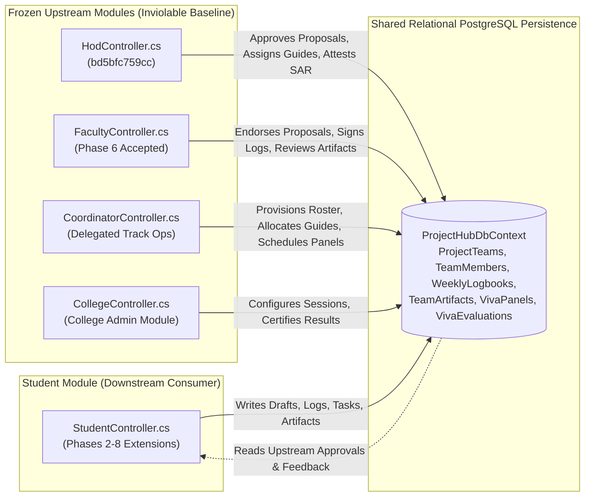

# COLABEX — STUDENT MODULE
# DELIVERABLE 7: FROZEN MODULE INTEGRATION MATRIX
**Phase 1: Complete System Audit, Academic Lifecycle Discovery & Implementation Blueprint**
**Date:** November 24, 2026  
**Status:** Inviolable Architectural Integration Baseline  
**Governing Rule:** Zero Source Modifications to Frozen Controllers or Accepted Modules  

---

## 1. INTEGRATION ARCHITECTURE OVERVIEW

The Student Module is designed as a **downstream consumer** of institutional workflows established by the upstream role modules. The upstream modules have passed final acceptance and are frozen:
1. **Department HOD Module:** Protected baseline commit `bd5bfc759cc9c46befa04e6ea8c26c84862acea4` (`HodController.cs`).
2. **Faculty / Project Guide Module:** Phase 6 accepted and frozen (`FacultyController.cs`).
3. **Project Coordinator Delegated Responsibility:** Governed via `CoordinatorController.cs`.
4. **College Admin Module:** Final acceptance completed (`CollegeController.cs`).
5. **Super Admin Platform Governance:** Internally accepted (`PlatformController.cs`, `AccountController.cs`).

The Student Module integrates with these frozen modules exclusively through:
- Reading shared persisted relational database entities.
- Consuming public, existing endpoints where authorized.
- Triggering state transitions that upstream controllers expect.
- Introducing **new** student-facing endpoints in `StudentController.cs` without altering upstream contracts.

---

## 2. INTEGRATION CONTRACT MATRIX

| Frozen Module | Upstream Source File | Existing Endpoint / Method | Contract & Direction | Consumed Entity / Data | Student Module Interaction / Dependency | Compatibility Status | Escalation / Workaround |
| :--- | :--- | :--- | :--- | :--- | :--- | :--- | :--- |
| **HOD Module** | `HodController.cs` | `POST api/hod/proposals/{teamId}/approve` | HOD reviews and approves proposal | `ProjectTeams` (`Status = Approved`) | Student workspace transitions to `Approved` -> `Active` upon HOD approval. | **100% COMPATIBLE** | None. Consumes database status transition. |
| **HOD Module** | `HodController.cs` | `POST api/hod/proposals/{teamId}/reject` | HOD rejects proposal with remarks | `ProjectTeams` (`Status = Rejected`, `Remarks`) | Student workspace displays rejection remarks and prompts revision. | **100% COMPATIBLE** | None. Consumes database status transition. |
| **HOD Module** | `HodController.cs` | `POST api/hod/projects/{teamId}/assign-guide` | HOD directly assigns or reassigns guide | `ProjectTeams.GuideUserId` | Student workspace updates assigned guide card and contact information. | **100% COMPATIBLE** | None. Stamped directly on `ProjectTeams`. |
| **HOD Module** | `HodController.cs` | `POST api/hod/sar/attest` | HOD formally attests SAR Criterion 3 | `Department.IsSarAttested`, `SarAttestedAtUtc` | Locks department's project artifacts and evaluations against modification. | **100% COMPATIBLE** | Student UI shows "Locked for SAR Attestation". |
| **Faculty Module** | `FacultyController.cs` | `POST api/faculty/proposals/{teamId}/endorse` | Guide endorses proposal to HOD | `ProjectTeams.Status = PendingHOD` | Stepper GPS advances from "Guide Review" to "HOD Department Approval". | **100% COMPATIBLE** | Consumes database status transition. |
| **Faculty Module** | `FacultyController.cs` | `POST api/faculty/proposals/{teamId}/return` | Guide returns proposal for revision | `ProjectTeams.Status = NeedsRevision`, `Remarks` | Student workspace unlocks proposal for editing and displays faculty remarks. | **100% COMPATIBLE** | Consumes database status transition. |
| **Faculty Module** | `FacultyController.cs` | `POST api/faculty/logs/{logId}/verify` | Guide verifies Friday weekly logbook | `WeeklyLogbooks.IsVerified = true`, `MentorRemarks` | Weekly log badge updates to "Verified by Mentor" with mentor remarks. | **100% COMPATIBLE** | Consumes existing `WeeklyLogbooks` columns. |
| **Faculty Module** | `FacultyController.cs` | `POST api/faculty/artifacts/{artifactId}/review` | Guide verifies or returns artifact | `TeamArtifacts.Status`, `TeamArtifacts.ReviewerNote` | Vault slot updates status; if returned, student re-uploads deliverable. | **100% COMPATIBLE** | Consumes existing `TeamArtifacts` columns. |
| **Faculty Module** | `FacultyController.cs` | `POST api/faculty/evaluations` | Evaluator records 60/40 viva defense marks | `VivaEvaluations`, `IndividualStudentScores` | Feeds student evaluation report once published. | **100% COMPATIBLE** | Guide COI enforced upstream via `ConflictOfInterestGuard`. |
| **Coordinator Module** | `CoordinatorController.cs`| `POST api/coordinator/roster/student` | Coordinator provisions student account | `UserAccounts`, `StudentAcademicEnrollments` | Creates student user account, allowing student to log in via credentials. | **100% COMPATIBLE** | Feeds student identity lifecycle. |
| **Coordinator Module** | `CoordinatorController.cs`| `POST api/coordinator/teams/{teamId}/assign-guide`| Coordinator matches and allocates guide | `ProjectTeams.GuideUserId` | Updates student assigned guide card. | **100% COMPATIBLE** | Consumes existing `ProjectTeams.GuideUserId`. |
| **Coordinator Module** | `CoordinatorController.cs`| `POST api/coordinator/panels` | Coordinator schedules defense panel | `VivaPanels`, `VivaPanelEvaluators` | Student views defense date, time, and panel venue. | **100% COMPATIBLE** | Evaluators bound to Track & Dept; student views schedule. |
| **College Admin** | `CollegeController.cs` | `POST api/college/sessions` | College Admin opens academic session | `AcademicSessions` (`IsActive = true`) | Student dashboard shows active academic year (e.g. "2026–2027"). | **100% COMPATIBLE** | Reads active academic session. |
| **College Admin** | `CollegeController.cs` | `POST api/college/results/certify` | College Admin certifies exam tabulation | `CollegeTenant.ResultsCertifiedAtUtc` | Authorizes publication of final evaluation marks to students. | **100% COMPATIBLE** | Prerequisite for student evaluation visibility. |

---

## 3. INTEGRATION GAP ANALYSIS & ESCALATIONS

During the audit, only two minor integration observations were identified:

1. **Account Profile Authorization Discrepancy:**
   - *Observation:* `AccountController.cs` has `[Authorize(Policy = ProjectHubPolicies.SuperAdminOnly)]`.
   - *Resolution without changing frozen code:* We will NOT touch `AccountController.cs`. Instead, we will implement dedicated `GET /api/student/profile` and `PUT /api/student/profile` within `StudentController.cs` under `StudentOrLead` policy.
2. **Viva Defense Binding Scope:**
   - *Observation:* The existing Faculty module contract binds `VivaPanel` to `DepartmentId` and `AcademicTrackId`, rather than linking individual `ProjectTeamId` directly to a panel.
   - *Resolution without changing frozen code:* When a student queries `GET /api/student/viva-schedule`, the backend will resolve the student team's `(DepartmentId, AcademicTrackId)` and query active `VivaPanels` for that track. This perfectly aligns with existing architecture without requiring schema mutations to frozen tables.
