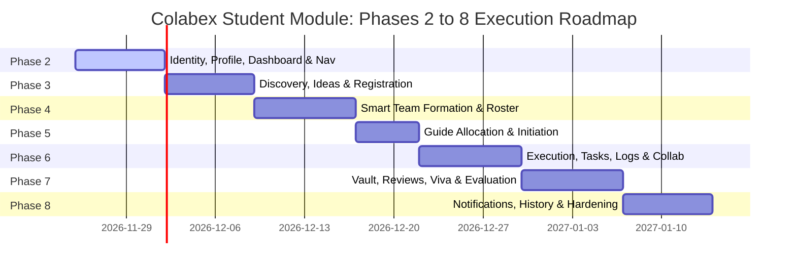

# COLABEX — STUDENT MODULE
# DELIVERABLE 11: PHASE 2 TO 8 IMPLEMENTATION ROADMAP
**Phase 1: Complete System Audit, Academic Lifecycle Discovery & Implementation Blueprint**
**Date:** November 24, 2026  
**Status:** Approved Engineering Implementation Sequence  
**Guiding Principle:** Iterative Domain Realization with Zero Frozen Module Modifications  

---

## 1. IMPLEMENTATION ROADMAP OVERVIEW

Every one of the 68 atomic requirements identified in the RTM (Deliverable 2) is mapped to an implementation phase. No requirement is omitted or left unassigned.

---

## 2. PHASE-BY-PHASE EXECUTION BLUEPRINT

### PHASE 2: Student Identity, Onboarding, Permanent Profile, Dashboard & Navigation
- **Requirement IDs:** `IDN-001`, `IDN-002`, `IDN-003`, `IDN-004`, `IDN-005`, `IDN-006`, `IDN-007`, `IDN-008`, `IDN-009`, `IDN-010`, `PROF-001`, `PROF-002`, `PROF-003`, `PROF-004`, `PROF-005`, `PROF-006`, `DASH-001`, `DASH-002`, `DASH-003`, `DASH-004`, `DASH-005`, `NAV-001`, `NAV-002`, `NAV-003`.
- **Existing Code to Reuse:** `AuthController.cs` (login/OTP), `TenantResolutionMiddleware.cs`, `StudentProfileView.tsx`, `routeRegistry.ts`.
- **Missing Implementation:**
  - Backend: Implement `GET /api/student/dashboard` and `GET/PUT /api/student/profile` in `StudentController.cs`.
  - Frontend: Replace mock persona in `StudentProfileView.tsx` with real API calls; implement unallocated empty state on `/student`.
- **Entry Criteria:** Phase 1 audit accepted.
- **Exit Criteria:** Student logs in, views verified dashboard (allocated or unallocated), and updates skills/handles with database persistence. Baseline tests 100% green.

---

### PHASE 3: Project Discovery, Idea Management & Project Registration
- **Requirement IDs:** `DISC-001`, `DISC-002`, `DISC-003`, `IDEA-001`, `IDEA-002`, `IDEA-003`, `IDEA-004`, `IDEA-005`, `REG-001`, `REG-002`, `REG-003`, `REG-004`.
- **Existing Code to Reuse:** `StudentController.cs` (`GetProblemBank`), trigram similarity GIN index `IX_ProjectTeams_Title_Trgm`.
- **Missing Implementation:**
  - Backend: Endpoints `POST /api/student/ideas`, `POST /api/student/ideas/{id}/submit`, `POST /api/student/ideas/{id}/resubmit`, `POST /api/student/check-similarity`.
  - Frontend: Idea proposal submission wizard with real-time trigram similarity warning banner.
- **Exit Criteria:** Student drafts an idea, checks title similarity, submits proposal to guide, and receives return remarks.

---

### PHASE 4: Smart Team Formation & Team Management
- **Requirement IDs:** `TEAM-001`, `TEAM-002`, `TEAM-003`, `TEAM-004`, `TEAM-005`, `TEAM-006`, `TEAM-007`, `TEAM-008`, `TEAM-009`, `TEAM-010`, `TEAM-011`, `TEAM-012`.
- **Missing Implementation:**
  - Database: Add `TeamInvitations` entity and EF Core migration.
  - Backend: Endpoints `GET /api/student/peers`, `POST /api/student/teams`, `POST /api/student/teams/invitations`, `POST /api/student/invitations/{id}/accept`, `reject`, `leave`. Serialized transaction on capacity.
  - Frontend: Peer discovery grid with invitation modals, received invitations drawer.
- **Exit Criteria:** Team leader creates team, searches peers, dispatches invites; peer accepts; capacity strictly capped at 4 with concurrency locks.

---

### PHASE 5: Guide Allocation & Project Initiation
- **Requirement IDs:** `GUIDE-001`, `GUIDE-002`, `GUIDE-003`, `INIT-001`, `INIT-002`, `INIT-003`.
- **Existing Code to Reuse:** `CoordinatorController.cs` (`AssignGuide`), `HodController.cs` (`ApproveProposal`).
- **Missing Implementation:**
  - Backend: Endpoints `PUT /api/student/team/repo` and `PUT /api/student/team/jira`. Guide reassignment event hook.
  - Frontend: GitHub repo and Jira configuration modals in workspace roster tab.
- **Exit Criteria:** Project transitions to `Active` after HOD approval; assigned guide details display in workspace; team links GitHub repo.

---

### PHASE 6: Project Execution, Tasks, Milestones, Logbooks, Collaboration & Contribution Tracking
- **Requirement IDs:** `TASK-001`, `TASK-002`, `TASK-003`, `TASK-004`, `MILE-001`, `MILE-002`, `LOG-001`, `LOG-002`, `LOG-003`, `COLLAB-001`, `CONTRIB-001`.
- **Existing Code to Reuse:** `StudentController.cs` (`tasks`, `logs`), `WeeklyLogbooks` table, `SprintTasks` table.
- **Missing Implementation:**
  - Database: `ProjectMilestones` table.
  - Backend: `GET /api/student/milestones`, transparent contribution calculation service aggregating verified hours and commits.
  - Frontend: Milestone checklist StepperGPS; individual contribution progress bar.
- **Exit Criteria:** Team creates and completes sprint tasks; submits weekly Friday logs; guide verifies; milestone countdown accurately reflects dates.

---

### PHASE 7: Deliverables, Artifact Management, Submissions, Faculty Reviews, Viva & Evaluation
- **Requirement IDs:** `FILE-001`, `FILE-002`, `FILE-003`, `FILE-004`, `SUB-001`, `REV-001`, `VIVA-001`, `VIVA-002`, `EVAL-001`, `EVAL-002`.
- **Existing Code to Reuse:** 4-slot Vault in `StudentController.cs`, `ArtifactsController.cs`, `ConflictOfInterestGuard.cs`.
- **Missing Implementation:**
  - Backend: `POST /api/student/submit-final`, `GET /api/student/viva-schedule`, `GET /api/student/evaluation` with publication guard.
  - Frontend: "Evaluations & Defense" subtab rendering certified 60/40 blended marksheet.
- **Exit Criteria:** Deliverables uploaded to vault; guide reviews; team submits final capstone; defense panel scheduled; certified marks visible to students.

---

### PHASE 8: Notifications, Academic History, Complete Integration Testing, Security Verification, Acceptance & Freeze
- **Requirement IDs:** `NOTIF-001`, `NOTIF-002`, `HIST-001`, `HIST-002`, `SEC-001`, `SEC-002`, `TEST-001`.
- **Missing Implementation:**
  - Database: `StudentNotifications` table; RLS extension to all newer Phase 2 tables.
  - Backend: `GET /api/student/notifications`, `GET /api/public/verify/{usn}`.
  - QA: Execution of all 36 End-to-End Journeys via Playwright and xUnit.
- **Exit Criteria:** In-app notification engine active; multi-year project lineage verified; public QR transcript functional; all 36 Journeys pass; formal Student Module freeze.
