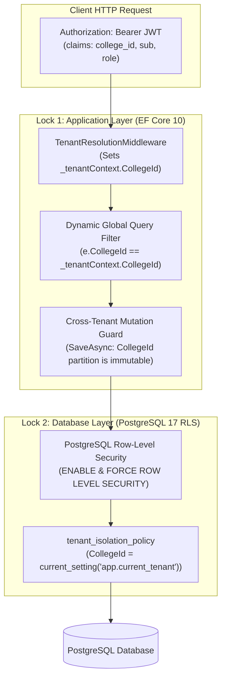

# COLABEX — STUDENT MODULE
# DELIVERABLE 6: ROLE, PERMISSION & SECURITY MATRIX
**Phase 1: Complete System Audit, Academic Lifecycle Discovery & Implementation Blueprint**
**Date:** November 24, 2026  
**Security Standard:** Enterprise Multi-Tenant Zero-Trust / OWASP Top 10 API Security  
**Scope:** Explicit Allow/Deny Authority Matrix Across All Campus Personas  

---

## 1. ROLE AND PERMISSION MATRIX

The Colabex platform enforces strict separation of responsibilities between permanent system roles, delegated institutional duties (Project Coordinator), and project-specific roles (Team Leader):

- **STU:** Student (Regular team member or individual learner)
- **LEAD:** Team Leader (Project-specific responsibility assigned to 1 student member)
- **FAC:** Faculty / Assigned Project Guide
- **COORD:** Project Coordinator (Delegated faculty responsibility with track authority)
- **HOD:** Department Head (Department academic governance)
- **EVAL:** Viva Panel Evaluator (Faculty appointed to examine panel defenses)
- **CADM:** College Administrator (Institutional registry and compliance authority)
- **SADM:** Super Administrator (Platform operator governance only; no direct student grading overrides)

### Permission Definitions:
- **ALLOW:** Unrestricted authorized operation within verified tenant and object scope.
- **OWN:** Authorized strictly for entities owned by the caller or where caller is a member.
- **DENY:** Strictly forbidden; returns HTTP 403 Forbidden or HTTP 401 Unauthorized.
- **READ:** Read-only access within tenant and departmental boundary.

---

| Operation / Capability | STU | LEAD | FAC | COORD | HOD | EVAL | CADM | SADM | Security Guard / Rule |
| :--- | :---: | :---: | :---: | :---: | :---: | :---: | :---: | :---: | :--- |
| **Login & Password Reset OTP** | ALLOW | ALLOW | ALLOW | ALLOW | ALLOW | ALLOW | ALLOW | ALLOW | Anti-enumeration; rate-limited (10 req/min). |
| **View Own Academic Profile** | OWN | OWN | OWN | OWN | OWN | OWN | OWN | OWN | Tenant-isolated to `_tenantContext.UserId`. |
| **Update Own Skills & Bio** | OWN | OWN | OWN | OWN | OWN | OWN | OWN | OWN | Cannot mutate USN, College, or Dept. |
| **Mutate University USN / Roll No** | **DENY** | **DENY** | **DENY** | ALLOW | ALLOW | **DENY** | ALLOW | **DENY** | Institutional record; locked to admin/coordinator. |
| **Browse Problem Bank Statements** | READ | READ | ALLOW | ALLOW | ALLOW | READ | READ | READ | Read-only to students; faculty create statements. |
| **Create Project Idea Proposal** | ALLOW | ALLOW | **DENY** | **DENY** | **DENY** | **DENY** | **DENY** | **DENY** | Students initiate project proposals. |
| **Submit Proposal for Guide Review** | **DENY** | OWN | **DENY** | **DENY** | **DENY** | **DENY** | **DENY** | **DENY** | Only Team Lead can formally submit proposal. |
| **Endorse Project Proposal** | **DENY** | **DENY** | OWN | ALLOW | ALLOW | **DENY** | **DENY** | **DENY** | Assigned guide endorses proposal to HOD. |
| **Approve / Reject Proposal (Final)** | **DENY** | **DENY** | **DENY** | **DENY** | ALLOW | **DENY** | **DENY** | **DENY** | Exclusive authority of Department HOD. |
| **Create Project Team Roster** | ALLOW | ALLOW | **DENY** | ALLOW | ALLOW | **DENY** | ALLOW | **DENY** | Student creates team or coordinator provisions. |
| **Invite Classmate to Team** | **DENY** | OWN | **DENY** | ALLOW | ALLOW | **DENY** | **DENY** | **DENY** | Lead invites peer; subject to track capacity. |
| **Accept / Decline Team Invite** | OWN | OWN | **DENY** | **DENY** | **DENY** | **DENY** | **DENY** | **DENY** | Invited student only; atomic slot reservation. |
| **Transfer Team Leadership** | **DENY** | OWN | **DENY** | ALLOW | ALLOW | **DENY** | **DENY** | **DENY** | Lead transfers to another active member. |
| **Leave Team (Voluntary Exit)** | OWN | **DENY** | **DENY** | **DENY** | **DENY** | **DENY** | **DENY** | **DENY** | Permitted ONLY in `Draft` state; lead cannot leave without transfer. |
| **Allocate / Reassign Guide** | **DENY** | **DENY** | **DENY** | ALLOW | ALLOW | **DENY** | ALLOW | **DENY** | Students are strictly prohibited from self-allocating guides. |
| **Create / Update Sprint Tasks** | OWN | OWN | READ | READ | READ | **DENY** | READ | **DENY** | Team members manage internal sprint tasks. |
| **Submit Weekly Sprint Logbook** | OWN | OWN | **DENY** | **DENY** | **DENY** | **DENY** | **DENY** | **DENY** | Individual student logs own accomplishments. |
| **Verify / Sign Off Weekly Logbook** | **DENY** | **DENY** | OWN | ALLOW | ALLOW | **DENY** | **DENY** | **DENY** | Assigned guide verifies weekly discipline. |
| **Upload Deliverable Binary (Vault)** | OWN | OWN | **DENY** | **DENY** | **DENY** | **DENY** | **DENY** | **DENY** | Max 25MB, PDF/PPT, SHA-256 integrity hash. |
| **Download Deliverable Binary** | OWN | OWN | OWN | ALLOW | ALLOW | OWN | ALLOW | ALLOW | Restrictive ACL in `ArtifactsController.cs`. |
| **Review / Return Deliverable** | **DENY** | **DENY** | OWN | ALLOW | ALLOW | **DENY** | **DENY** | **DENY** | Faculty sets status and reviewer notes. |
| **Schedule Viva Defense Panel** | **DENY** | **DENY** | **DENY** | ALLOW | ALLOW | **DENY** | ALLOW | **DENY** | Coordinator/HOD manages defense panels. |
| **Submit Viva Defense Marks** | **DENY** | **DENY** | **DENY** | **DENY** | **DENY** | OWN | **DENY** | **DENY** | Evaluator submits 60/40 rubric; Guide COI blocked. |
| **View Uncertified Draft Marks** | **DENY** | **DENY** | **DENY** | ALLOW | ALLOW | OWN | ALLOW | **DENY** | Confidential draft; hidden from students. |
| **View Published Final Marks** | OWN | OWN | OWN | ALLOW | ALLOW | OWN | ALLOW | READ | Visible to student ONLY after formal publication. |
| **Submit NBA Course Exit Survey** | OWN | OWN | **DENY** | **DENY** | **DENY** | **DENY** | **DENY** | **DENY** | Student evaluates 5 POs; feeds SAR Criterion 3. |

---

## 2. TENANT ISOLATION ARCHITECTURE: DOUBLE-LOCK DEFENSE

### Verified Multi-Tenancy Invariants:
1. **Zero Cross-College Exposure:** Every database read and write automatically incorporates `CollegeId`. Even if an attacker guesses a valid UUID belonging to another institution, the EF Core filter and PostgreSQL RLS reject the record.
2. **Super Admin Isolation Guard:** Super Admins cannot override college academic marks or certifications without leaving an immutable audit record in `PlatformAuditLogs`.

---

## 3. THREAT MODELING & MITIGATION STRATEGY

| Threat Vector | Attack Scenario | Platform Countermeasure / Mitigation |
| :--- | :--- | :--- |
| **BOLA / IDOR (API Level)** | Student A changes `taskId` in URL to modify Student B's task. | `StudentController` asserts `task.ProjectTeamId == callerTeam.Id`. Rejects mismatched updates with HTTP 404/403. |
| **Privilege Escalation** | Student sends `role: "HOD"` in profile update request. | Student endpoints do not accept role parameters; role is strictly derived from the cryptographically signed JWT. |
| **Team Capacity Race Condition** | Two students simultaneously accept invites to fill the last available seat. | Serialized database transaction with row-level locking on `ProjectTeams` prevents overselling team capacity. |
| **Guide Conflict of Interest** | Guide evaluates their own mentored team on a viva panel. | `ConflictOfInterestGuard.EnsureNoVivaGradingConflict()` blocks mark submission if evaluator ID matches `GuideUserId`. |
| **Premature Mark Exposure** | Student queries `/api/student/evaluation` before marks are published. | Backend evaluation query checks `VivaEvaluation.IsCertified == true` and publication status; returns HTTP 403 Forbidden if uncertified. |
| **Malicious Deliverable Upload** | Student uploads an executable script disguised as a capstone thesis. | Strict file extension validation (`.pdf`, `.ppt`, `.pptx`), MIME-type sniffing, 25MB ceiling, and non-executable disk vault storage. |
