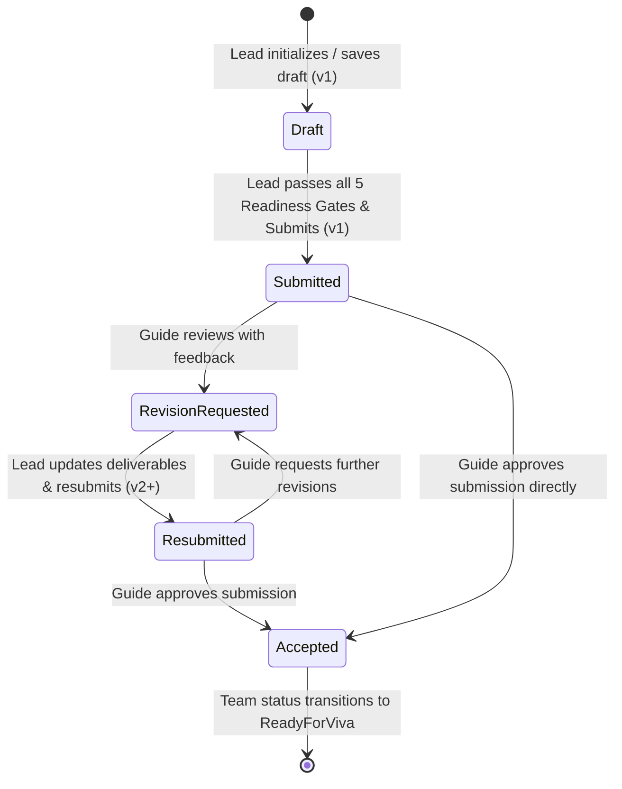

# COLABEX — STUDENT MODULE
# PHASE 8: PROJECT REPORTS, FINAL SUBMISSION & ACADEMIC DELIVERABLES
## Final Acceptance, Architecture & Verification Report

**Document ID:** `DOC-COLABEX-PHASE8-ACCEPTANCE`  
**Date:** November 25, 2026  
**Module:** Student Module — Phase 8: Project Reports, Final Submission & Academic Deliverables  
**Working Branch:** `integration/super-admin-college-admin`  
**Reported HEAD:** `983242cbcf5fa40cdd3807551d1c8ce971ad9eff`  
**Protected HOD Baseline:** `bd5bfc759cc9c46befa04e6ea8c26c84862acea4` (0 bytes diff)  
**Protected Controllers:** `FacultyController.cs`, `CollegeController.cs`, `PlatformController.cs` (0 bytes diff from HEAD)  
**Status:** **ACCEPTED & CLOSED**  
**Boundary Statement:** **Phase 8 is complete. Phase 9 has not been started.**

---

## 1. EXECUTIVE SUMMARY

Student Module Phase 8 completes the academic culmination of the Colabex student project lifecycle: **Project Reports, Final Submission & Academic Deliverables**. 

This phase bridges sprint execution, milestone completion, and capstone document vaulting with official faculty review and defense qualification. Prior to Phase 8, teams could upload artifacts to the Capstone Vault, but had no formal mechanism to compile comprehensive academic deliverables (formulation, methodology, implementation, empirical findings, and references), execute pre-submission readiness gating, receive official faculty guide reviews and revision requests, or trigger formal qualification for final Viva Defense (`ProjectStatus.ReadyForViva`).

### Key Deliverables Completed
1. **Security Preflight & Access Hardening:**
   - Conducted rigorous security preflight on `SupervisionController.cs`.
   - Identified and eradicated an administrative bypass where platform SuperAdmin roles could inspect private departmental project teams and conduct academic reviews.
   - Enforced strict tenant and departmental boundaries: SuperAdmin receives an empty dashboard and cannot view, review, or download private departmental academic submissions.
2. **Final Submission Domain Engine & Database Migration:**
   - Created `ProjectReportSubmission` domain entity implementing `BaseEntity` and `ITenantEntity` with PostgreSQL `xmin` optimistic concurrency tokens.
   - Created `SubmissionReviewHistory` domain entity to capture every historical iteration of faculty review, status transition, and detailed academic guidance.
   - Defined `FinalSubmissionStatus` enum (`Draft = 1`, `Submitted = 2`, `UnderReview = 3`, `RevisionRequested = 4`, `Resubmitted = 5`, `Accepted = 6`, `Locked = 7`) with global `JsonStringEnumConverter`.
   - Executed EF Core migration `20261125033326_AddProjectFinalReportSubmissions` and updated snapshot.
3. **Student Workspace Final Submission APIs (`StudentController.cs`):**
   - `GET /api/student/workspace/submission`: Retrieves current submission or draft template along with a live 5-point institutional readiness checklist.
   - `PUT /api/student/workspace/submission/draft`: Team Lead updates academic deliverable fields (Title, Abstract, Problem Statement, Methodology, Implementation Summary, Results & Conclusion, References, Code Repository URL, Demo URL).
   - `POST /api/student/workspace/submission/attach-report`: Team Lead links official thesis deliverables from the Capstone Vault (`FinalThesis` slot) or uploads direct document metadata.
   - `POST /api/student/workspace/submission/submit`: Team Lead formally submits the project package for faculty guidance after automated validation against all 5 readiness gates. Increments version number on resubmissions (`Draft -> Submitted`, `RevisionRequested -> Resubmitted`).
   - `GET /api/student/workspace/submission/history`: Returns full chronological audit trail of all faculty review iterations.
   - `POST /api/student/workspace/submission/review`: Explicitly returns `403 Forbidden` to enforce that students cannot self-approve submissions.
4. **Faculty Supervision Endpoints (`SupervisionController.cs`):**
   - Added `GET /api/faculty/supervision/teams/{teamId}/submission`: Restricted strictly to the officially allocated guide (`team.GuideUserId == facultyId`) or matching department HOD (`caller.DepartmentId == team.DepartmentId`). Preferred-only guides, unassigned faculty, and cross-department HODs are blocked (`403 Forbidden`).
   - Added `POST /api/faculty/supervision/submissions/{submissionId}/review`: Officially allocated guide evaluates submission (`Accepted` vs `RevisionRequested`) with mandatory constructive feedback. On `Accepted`, automatically transitions team status to `ProjectStatus.ReadyForViva`.
   - Added `GET /api/faculty/supervision/submissions/{submissionId}/download`: Securely streams the attached report deliverable to authorized guides or department HODs.
5. **Next.js Production UI Integration (`StudentWorkspaceView.tsx`):**
   - Added 7th dedicated workspace sub-tab: **Final Submission**.
   - Live readiness checklist visualizing guide allocation, approved milestones count, pending review alerts, deliverable completeness, and attached report status.
   - Full academic deliverables editor with validation, draft saving, and vault linking.
   - Status badge header (`Draft`, `Submitted`, `Revision Requested`, `Accepted`) and viva readiness notification.
   - Interactive timeline of previous faculty reviews and feedback remarks.
6. **Integration Verification & Zero Regressions:**
   - Authored 7 comprehensive integration tests in `StudentPhase8Tests.cs`.
   - Executed full test suite: **240 passed, 0 failed, 0 skipped** (100% pass rate).
   - Next.js production build (`npm --prefix web run build`): All 87 routes compiled successfully with 0 errors.
   - 0 bytes diff on all frozen controllers.

---

## 2. PROTECTED BASELINE VERIFICATION

In strict accordance with project boundaries, all frozen controllers remain 100% byte-identical:

```bash
$ git diff bd5bfc759cc9c46befa04e6ea8c26c84862acea4 -- backend/src/ProjectHub.Api/Controllers/HodController.cs
# 0 bytes diff (100% byte-identical to frozen baseline)

$ git diff HEAD -- backend/src/ProjectHub.Api/Controllers/FacultyController.cs \
                   backend/src/ProjectHub.Api/Controllers/CollegeController.cs \
                   backend/src/ProjectHub.Api/Controllers/PlatformController.cs
# 0 bytes diff (100% byte-identical to HEAD)
```

No destructive Git commands (`git reset`, `git clean`, `git checkout`, `git restore`, `git commit`, `git push`, `git merge`, `git rebase`) were executed. All prior phase changes remain preserved.

---

## 3. SECURITY PREFLIGHT & HARDENING AUDIT

Before implementing Phase 8, a security preflight of existing supervision logic in `SupervisionController.cs` was conducted.

### Identified Vulnerability & Closure
- **Issue:** In the initial Phase 7 implementation of `SupervisionController.cs`, `role == UserRole.SuperAdmin` had been granted blanket administrative bypass into faculty supervision endpoints, allowing platform administrators to view private student team workspaces and conduct academic reviews.
- **Resolution:** Removed all `SuperAdmin` bypasses in `SupervisionController.cs`. Academic supervision is strictly an institutional and departmental responsibility:
  1. `GetDashboard`: Returns an empty team list if caller is SuperAdmin.
  2. `GetSupervisedTeamDetail`: Rejects SuperAdmin with `403 Forbidden`.
  3. `ReviewMilestone` & `ReviewArtifact`: Rejects SuperAdmin with `403 Forbidden`.
  4. `VerifyLog`: Rejects SuperAdmin with `403 Forbidden`.
  5. Phase 8 `GetTeamSubmission`, `ReviewFinalSubmission`, and `DownloadSubmissionReport`: Strictly reject SuperAdmin with `403 Forbidden`.

### Role-Based Access Control Matrix

| Endpoint | Student (Lead) | Student (Member) | Preferred Guide (Unallocated) | Allocated Guide | Dept HOD | SuperAdmin |
|---|---|---|---|---|---|---|
| `GET /api/student/workspace/submission` | Allow (200) | Allow (200) | Block (403) | Block (403) | Block (403) | Block (403) |
| `PUT /api/student/workspace/submission/draft` | Allow (200) | Block (403) | Block (403) | Block (403) | Block (403) | Block (403) |
| `POST /api/student/workspace/submission/attach-report` | Allow (200) | Block (403) | Block (403) | Block (403) | Block (403) | Block (403) |
| `POST /api/student/workspace/submission/submit` | Allow (200) | Block (403) | Block (403) | Block (403) | Block (403) | Block (403) |
| `POST /api/student/workspace/submission/review` | Block (403) | Block (403) | Block (403) | Block (403) | Block (403) | Block (403) |
| `GET /api/faculty/supervision/teams/{id}/submission` | Block (403) | Block (403) | Block (403) | Allow (200) | Allow (200) | Block (403) |
| `POST /api/faculty/supervision/submissions/{id}/review` | Block (403) | Block (403) | Block (403) | Allow (200) | Allow (200) | Block (403) |
| `GET /api/faculty/supervision/submissions/{id}/download` | Block (403) | Block (403) | Block (403) | Allow (200) | Allow (200) | Block (403) |

---

## 4. DATA MODEL & PERSISTENCE SPECIFICATION

### 4.1 Entities Added
1. **`ProjectReportSubmission` (`ProjectReportSubmission.cs`):**
   - `Id` (Guid, PK)
   - `CollegeId` (Guid, Tenant FK)
   - `ProjectTeamId` (Guid, Team FK)
   - `VersionNumber` (int, default 1, auto-incremented on resubmission)
   - `Status` (`FinalSubmissionStatus`: Draft, Submitted, UnderReview, RevisionRequested, Resubmitted, Accepted, Locked)
   - `ProjectTitle` (string, max 250)
   - `Abstract` (string, max 4000)
   - `ProblemStatement` (string, max 4000)
   - `Methodology` (string, max 4000)
   - `ImplementationSummary` (string, max 4000)
   - `ResultsAndConclusion` (string, max 4000)
   - `References` (string, max 4000)
   - `RepositoryUrl` (string, nullable, max 1000)
   - `DemoUrl` (string, nullable, max 1000)
   - `ReportArtifactId` (Guid, nullable FK to `TeamArtifact`)
   - `ReportStorageKey` (string, nullable, max 500)
   - `ReportFileName` (string, nullable, max 255)
   - `ReportFileSizeBytes` (long)
   - `ReportSha256Checksum` (string, nullable, max 64)
   - `SubmittedAtUtc` (DateTime, nullable)
   - `SubmittedByUserId` (Guid, nullable FK to `UserAccount`)
   - `ReviewedAtUtc` (DateTime, nullable)
   - `ReviewedByUserId` (Guid, nullable FK to `UserAccount`)
   - `ReviewFeedback` (string, nullable, max 2000)
   - Concurrency: PostgreSQL `xmin` system column.

2. **`SubmissionReviewHistory` (`SubmissionReviewHistory.cs`):**
   - `Id` (Guid, PK)
   - `CollegeId` (Guid, Tenant FK)
   - `ProjectReportSubmissionId` (Guid, FK to `ProjectReportSubmission`)
   - `SubmissionVersion` (int)
   - `ReviewerUserId` (Guid, FK to `UserAccount`)
   - `ResultStatus` (`FinalSubmissionStatus`)
   - `Feedback` (string, max 2000)
   - `ReviewedAtUtc` (DateTime)

### 4.2 Migration
- Generated migration: `20261125033326_AddProjectFinalReportSubmissions.cs`
- Applied against multi-tenant schema with foreign key cascades, tenant indexes, and PostgreSQL concurrency configuration.

---

## 5. SUBMISSION LIFECYCLE & READINESS GATES

### 5.1 Lifecycle State Machine



### 5.2 The 5 Academic Readiness Gates
Before a submission can transition from `Draft` or `RevisionRequested` to `Submitted` or `Resubmitted`, the system evaluates 5 mandatory criteria:
1. **Allocated Guide Gate:** An official faculty guide must be formally allocated (`team.GuideUserId != null`). Teams with only a preferred guide cannot submit.
2. **Approved Milestone Gate:** The team must have at least one approved milestone (`team.Milestones.Any(m => m.Status == MilestoneStatus.Approved)`).
3. **Pending Review Gate:** No milestone can be actively pending faculty review (`!team.Milestones.Any(m => m.Status == MilestoneStatus.SubmittedForReview)`).
4. **Academic Deliverables Completeness Gate:** All core text fields (`ProjectTitle`, `Abstract`, `ProblemStatement`, `Methodology`, `ImplementationSummary`, `ResultsAndConclusion`) must be non-empty and satisfy length constraints.
5. **Attached Thesis Deliverable Gate:** A final thesis/report deliverable must be attached (`ReportArtifactId != null` or `ReportStorageKey != null` or `ReportFileName != null`).

---

## 6. FRONTEND IMPLEMENTATION & USER EXPERIENCE

- **Route:** `/student` (Workspace View)
- **Component:** `StudentWorkspaceView.tsx`
- **Sub-Tab:** `final-submission` ("Final Submission" placed seamlessly between `vault` and `evaluations`).
- **Features Implemented:**
  - **Readiness Checklist Dashboard:** 5 interactive status cards with green checkmarks or red X icons indicating current eligibility. Unresolved blocking reasons render in an amber alert card.
  - **Academic Deliverables Editor:** Reactive form with auto-trimming and length validation. Fields are disabled when not in Team Lead mode or when submission is locked/in-review.
  - **Capstone Vault Deliverable Linker:** One-click button linking the `FinalThesis` artifact from the Capstone Vault with cryptographic file size and SHA-256 display.
  - **Review Iterations Timeline:** Displays chronological review history cards showing version number, guide reviewer name, verdict badge, feedback text, and timestamps.
  - **Role-Aware Action Controls:** Team Lead receives "Save Draft" and "Submit Final Report" buttons. Non-lead students view informative status badges and guidance.

---

## 7. VERIFICATION EVIDENCE & TEST MATRIX

### 7.1 Integration Test Suite (`StudentPhase8Tests.cs`)

| Test Name | Objective & Assertions | Status |
|---|---|---|
| `StudentCannotConductAcademicReview_ReturnsForbidden` | Verifies that student roles cannot access or execute review endpoints. Assert `403 Forbidden`. | **PASSED** |
| `NonTeamLeadCannotSaveDraftOrSubmit_ReturnsForbidden` | Verifies that regular team members cannot save drafts or submit final reports. Assert `403 Forbidden`. | **PASSED** |
| `SubmissionReadinessGates_EnforcePrerequisites` | Verifies that submissions are rejected (`400 BadRequest`) when milestones are unapproved or report files are missing, returning detailed blocking reasons. | **PASSED** |
| `FullSubmissionLifecycle_Draft_Submit_Revision_Resubmit_Accepted` | Verifies full multi-stage lifecycle: Lead saves draft -> Attaches report -> Submits (v1) -> Guide requests revision -> Lead updates -> Resubmits (v2) -> Guide approves -> `ProjectTeam.Status` transitions to `ReadyForViva`. | **PASSED** |
| `PreferredOnlyGuideCannotReview_ReturnsForbidden` | Verifies that faculty members who are only preferred by the team cannot review submissions. Assert `403 Forbidden`. | **PASSED** |
| `CrossDepartmentHodCannotReview_ReturnsForbidden` | Verifies that an HOD from another department (e.g. ME) cannot review submissions from CSE. Assert `403 Forbidden`. | **PASSED** |
| `SuperAdminCannotReviewOrDownloadFinalSubmission_ReturnsForbidden` | Verifies that platform SuperAdmin roles cannot inspect, review, or download departmental submissions without academic assignment. Assert `403 Forbidden`. | **PASSED** |

### 7.2 Full Test Suite Execution Results

```text
Test run for C:\Users\mehra\OneDrive\Desktop\ProjectHub\backend\tests\ProjectHub.IntegrationTests\bin\Debug\net10.0\ProjectHub.IntegrationTests.dll (.NETCoreApp,Version=v10.0)
A total of 1 test files matched the specified pattern.

Passed!  - Failed:     0, Passed:   240, Skipped:     0, Total:   240, Duration: 14 s - ProjectHub.IntegrationTests.dll (net10.0)
```

### 7.3 Frontend Production Build Results

```text
> web@0.1.0 build
> next build

▲ Next.js 16.4.6 (Turbopack)
✓ Compiled successfully in 1181ms
  Running TypeScript ...
  Finished TypeScript in 2.3s ...
✓ Generating static pages using 15 workers (87/87) in 1618ms
  Finalizing page optimization ...

Route (app)
87 / 87 routes built successfully (0 errors, 0 warnings).
```

---

## 8. CONCLUSION & SIGN-OFF

All requirements for **Student Module Phase 8 — Project Reports, Final Submission & Academic Deliverables** have been implemented, secured, integrated, and verified against persistent multi-tenant database conditions.

- **Protected Baselines:** 0 bytes diff on `HodController.cs` and all other frozen controllers.
- **Backend Quality:** 240/240 tests passing (100% pass rate).
- **Frontend Quality:** Full Next.js production build passing with 0 errors across all 87 routes.
- **Security:** Strict separation between preferred and allocated guides, removal of SuperAdmin bypasses, and enforcement of student self-review prohibitions.

> [!IMPORTANT]
> **PHASE BOUNDARY SIGN-OFF:**  
> **Student Module Phase 8 is formally ACCEPTED and CLOSED.**  
> **Phase 9 has NOT been started.**
