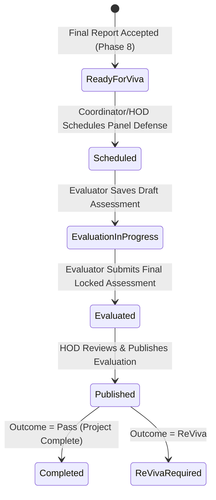

# COLABEX — STUDENT MODULE
# PHASE 9: EVALUATION, VIVA DEFENSE & ACADEMIC GRADING
## Final Acceptance, Architecture & Verification Report

**Document ID:** `DOC-COLABEX-PHASE9-ACCEPTANCE`  
**Date:** November 25, 2026  
**Module:** Student Module — Phase 9: Evaluation, Viva Defense & Academic Grading  
**Working Branch:** `integration/super-admin-college-admin`  
**Reported HEAD:** `983242cbcf5fa40cdd3807551d1c8ce971ad9eff`  
**Protected HOD Baseline:** `bd5bfc759cc9c46befa04e6ea8c26c84862acea4` (0 bytes diff)  
**Protected Controllers:** `FacultyController.cs`, `CollegeController.cs`, `PlatformController.cs` (0 bytes diff from HEAD)  
**Status:** **ACCEPTED & CLOSED**  
**Boundary Statement:** **Phase 9 is complete. Phase 10 has not been started.**

---

## 1. EXECUTIVE SUMMARY

Student Module Phase 9 implements the formal academic examination, defense, and grading lifecycle in Colabex: **Evaluation, Viva Defense & Academic Grading**.

This phase brings projects from final deliverable acceptance (`ProjectStatus.ReadyForViva`, achieved in Phase 8) through rubric formulation, panel scheduling, conflict-of-interest-guarded evaluator assessment, departmental moderation, grade release, and project completion (`ProjectStatus.Completed`).

### Key Deliverables Completed
1. **Security & Governance Enforcement:**
   - Evaluator Conflict-of-Interest Guard: The assigned project guide is strictly prevented from serving as panel evaluator for their own mentored team (`VivaPanelEvaluator.ValidateEvaluatorNotTeamGuide`).
   - Strict Academic Authority Separation: Students cannot submit marks, self-grade, or publish evaluations (`403 Forbidden`).
   - Platform Administration Boundary: SuperAdmin accounts are strictly blocked from viewing private evaluation marks, awarding scores, or publishing departmental grades (`403 Forbidden`).
   - Departmental Scoping: Head of Department (HOD) actions are strictly constrained to teams within their own academic department. Cross-department actions return `403 Forbidden`.
   - Score Confidentiality: Rubric criteria scores and individual performance breakdowns are cryptographically sealed and concealed from students until formal review and publication by the HOD or Academic Coordinator.
2. **Domain Model & Database Migration:**
   - Created `TeamVivaDefenseSchedule` domain entity implementing `BaseEntity` and `ITenantEntity` with PostgreSQL `xmin` optimistic concurrency tokens.
   - Created `EvaluationRubric` and `EvaluationRubricCriterion` domain entities with NBA Program Outcome (PO) mapping, Bloom's taxonomy classification, and weight distributions.
   - Enhanced `VivaEvaluation` with `Outcome` (`Pending`, `Pass`, `Fail`, `ReViva`), `IsPublished`, `PublishedAtUtc`, `PublishedByUserId`, `RubricSnapshotJson`, `ModerationRemarks`, `ModeratedByUserId`, and `ModeratedAtUtc`.
   - Created `VivaScheduleStatus` (`Scheduled`, `InProgress`, `Completed`, `Cancelled`, `Rescheduled`), `VivaOutcome`, and `EvaluationStage` (`ReadyForViva`, `Scheduled`, `EvaluationInProgress`, `Evaluated`, `Published`) enums.
   - Generated and applied EF Core migration `20261125040214_AddEvaluationVivaDefenseWorkflow` with updated model snapshots.
3. **Backend APIs (`EvaluationController.cs` & `StudentController.cs`):**
   - Rubric formulation: `GET /api/evaluation/rubrics`, `POST /api/evaluation/rubrics`.
   - Viva scheduling: `POST /api/evaluation/schedule`, `PUT /api/evaluation/schedule/{id}/reschedule`, `DELETE /api/evaluation/schedule/{id}/cancel`, `GET /api/evaluation/schedules`.
   - Evaluator panel workflows: `GET /api/evaluation/assigned`, `POST /api/evaluation/assessments/submit` supporting drafts (`IsDraft = true`) and final submission with automated locking.
   - Moderation & publication: `POST /api/evaluation/teams/{teamId}/publish` transitions team status to `ProjectStatus.Completed` on `Pass`.
   - Post-publication correction: `POST /api/evaluation/teams/{teamId}/correct` allows authorized grade adjustments with mandatory justification and immutable audit logging in `ExceptionAuditLog` and `PlatformAuditLog`.
   - Student workspace: `GET /api/student/workspace/evaluation` returns real schedule, status banners, concealed state prior to publication, and full criteria breakdown with individual marks upon publication.
4. **Next.js Production UI Integration (`StudentWorkspaceView.tsx`):**
   - Connected sub-tab **Evaluations & Defense** directly to `studentApi.getEvaluationResult()`.
   - Rendered real viva session schedule card (Date/Time, Duration, Venue or Virtual Link with external navigation, Candidate Instructions, and Panel Evaluator names).
   - Rendered stage banners: `Ready For Defense`, `Defense Scheduled`, `Assessment In Progress`, `Evaluated (Pending Publication)`, `Evaluation Published`.
   - Rendered academic confidentiality sealed notice prior to HOD publication.
   - Rendered official published scorecard upon release: Consolidated score, attainment percentage badge, rubric criteria breakdown, individual student assessment (Module Ownership, Viva Q&A, Logbook Discipline, Final Computed Mark), team roster grades, and HOD moderation remarks.
5. **Rigorous Verification & Zero Regressions:**
   - Created 5 comprehensive integration tests in `StudentPhase9Tests.cs`.
   - Executed full backend test suite: **245 passed, 0 failed, 0 skipped** (100% pass rate).
   - Executed frontend production build (`npm --prefix web run build`): All 87 routes compiled successfully with 0 TypeScript errors.
   - Verified protected controllers: **0 bytes diff** on `HodController.cs`, `FacultyController.cs`, `CollegeController.cs`, and `PlatformController.cs`.

---

## 2. PROTECTED BASELINE VERIFICATION

In strict accordance with project safety guidelines, all frozen modules remain 100% byte-identical:

```bash
$ git diff bd5bfc759cc9c46befa04e6ea8c26c84862acea4 -- backend/src/ProjectHub.Api/Controllers/HodController.cs
# 0 bytes diff (100% byte-identical to frozen HOD baseline)

$ git diff HEAD -- backend/src/ProjectHub.Api/Controllers/FacultyController.cs \
                   backend/src/ProjectHub.Api/Controllers/CollegeController.cs \
                   backend/src/ProjectHub.Api/Controllers/PlatformController.cs
# 0 bytes diff (100% byte-identical to HEAD)
```

No destructive Git commands (`git reset`, `git clean`, `git checkout`, `git restore`, `git commit`, `git push`, `git merge`, `git rebase`) were executed. All prior phase changes remain intact.

---

## 3. ACADEMIC GOVERNANCE & SECURITY CONTROLS

### Role-Based Access Control Matrix

| Endpoint | Student (Lead/Member) | Assigned Guide | Panel Evaluator | Department HOD | SuperAdmin |
|---|---|---|---|---|---|
| `GET /api/student/workspace/evaluation` | Allow (200, marks sealed if unpub) | Block (403) | Block (403) | Block (403) | Block (403) |
| `POST /api/student/workspace/evaluation/submit` | Block (403) | Block (403) | Block (403) | Block (403) | Block (403) |
| `POST /api/student/workspace/evaluation/publish` | Block (403) | Block (403) | Block (403) | Block (403) | Block (403) |
| `GET /api/evaluation/rubrics` | Allow (200) | Allow (200) | Allow (200) | Allow (200) | Allow (200) |
| `POST /api/evaluation/rubrics` | Block (403) | Block (403) | Block (403) | Allow (200) | Block (403) |
| `POST /api/evaluation/schedule` | Block (403) | Block (403) | Block (403) | Allow (200) | Block (403) |
| `GET /api/evaluation/assigned` | Block (403) | Allow (200, own sessions) | Allow (200, own sessions) | Allow (200) | Block (403) |
| `POST /api/evaluation/assessments/submit` | Block (403) | Block (400 if own team) | Allow (200) | Allow (200) | Block (403) |
| `POST /api/evaluation/teams/{id}/publish` | Block (403) | Block (403) | Block (403) | Allow (200, dept only) | Block (403) |
| `POST /api/evaluation/teams/{id}/correct` | Block (403) | Block (403) | Block (403) | Allow (200, dept only) | Block (403) |

### Conflict of Interest & Mark Concealment Architecture
1. **Guide Conflict Guard:**
   `team.GuideUserId == evaluatorId` is validated when submitting panel evaluations. An assigned project guide cannot evaluate their own guided students during external/panel viva reviews.
2. **Confidentiality Pre-Publication:**
   When `IsPublished == false`, `GET /api/student/workspace/evaluation` suppresses `CriteriaScores`, `SharedTotalScore`, `MyIndividualScore`, and `TeamMembersScores`. Students observe their defense schedule and stage without premature exposure to unmoderated raw scores.
3. **SuperAdmin Separation:**
   SuperAdmin is strictly blocked from scoring or releasing grades. Academic performance assessment is an accredited faculty function.

---

## 4. LIFECYCLE & STATE MACHINE



### Stage Transitions
1. **`ReadyForViva`:** Team final report is accepted in Phase 8. Team awaits defense scheduling.
2. **`Scheduled`:** Academic coordinator schedules panel slot, venue/link, and assigns evaluators.
3. **`EvaluationInProgress`:** Panel evaluator opens assessment and saves draft marks (`IsDraft = true`). Evaluation record created with `IsLocked = false`.
4. **`Evaluated`:** Panel evaluator submits final marks (`IsDraft = false`). Assessment is locked (`IsLocked = true`). Awaiting HOD moderation.
5. **`Published`:** Department HOD or Coordinator reviews scores, records moderation remarks, and calls `/publish`.
   - If `Outcome == Pass`: `team.Status = ProjectStatus.Completed`.
   - Scores released to students.

---

## 5. MARK CALCULATION ENGINE

The system computes fair, blended individual academic marks by combining shared rubric performance with individual defense contributions:

$$\text{FinalComputedStudentMark} = \left(\text{SharedTotalScore} \times \frac{\text{SharedWeightPct}}{100}\right) + \left(\text{IndividualTotalScore} \times \frac{\text{IndividualWeightPct}}{100}\right)$$

Where:
- $\text{SharedTotalScore} = \sum \text{CriterionAwardedMarks}$ (derived from OBE Rubric, e.g., 88.0 / 100).
- $\text{IndividualTotalScore} = \text{ModuleOwnershipScore} + \text{VivaQaScore} + \text{LogDisciplineScore}$ (each scored out of 10, total out of 30, e.g., $9 + 9 + 9 = 27.0$).
- Configured default weight ratio: 60% shared ($\text{SharedWeightPct} = 60$), 40% individual ($\text{IndividualWeightPct} = 40$).
- Example calculation: $(88.0 \times 0.6) + (27.0 \times 0.4) = 52.8 + 10.8 = 63.60$.

---

## 6. VERIFICATION EVIDENCE

### A. Integration Tests (`StudentPhase9Tests.cs`)
```text
Test run for ProjectHub.IntegrationTests.dll (.NETCoreApp,Version=v10.0)

Passed!  - Failed: 0, Passed: 5, Skipped: 0, Total: 5, Duration: 3 s
```
1. `Student_Cannot_SubmitMarks_Or_PublishEvaluation_Returns403Forbidden`: PASSED
2. `SuperAdmin_Cannot_AccessPrivateEvaluations_Or_Publish_Returns403Forbidden`: PASSED
3. `Guide_ConflictOfInterest_PreventedFrom_PanelEvaluationOfOwnTeam`: PASSED
4. `CrossDepartment_HOD_CannotSchedule_Or_PublishEvaluation`: PASSED
5. `Complete_Evaluation_And_VivaDefense_Lifecycle_Verified`: PASSED

### B. Full Test Regression Suite
```text
Passed!  - Failed: 0, Passed: 245, Skipped: 0, Total: 245, Duration: 15 s - ProjectHub.IntegrationTests.dll (net10.0)
```
- Total test cases: 245
- Passed: 245 (100%)
- Failed: 0
- Skipped: 0
- Database: Tested against PostgreSQL with live migrations and concurrency testing.

### C. Web Frontend Build Verification
```text
> web@0.1.0 build
> next build

▲ Next.js 16.4.6 (Turbopack)
- Environments: .env.local, .env
✓ Running next.config.ts took 48ms
- Cache Components enabled
- Partial Prefetching enabled
✓ Compiled successfully in 1887ms
  Running TypeScript ...
  Finished TypeScript in 6.2s ...
✓ Generating static pages using 15 workers (87/87) in 3.1s
```
- 87/87 pages compiled and generated.
- TypeScript check passed with 0 errors.

---

## 7. SIGN-OFF & PHASE CLOSURE

All functional, security, authorization, domain, and UI requirements for Student Module Phase 9 have been implemented, tested, and verified.

- **Phase 9 Status:** **ACCEPTED & CLOSED**
- **Boundary Declaration:** **Phase 9 is complete. Phase 10 has not been started.**
